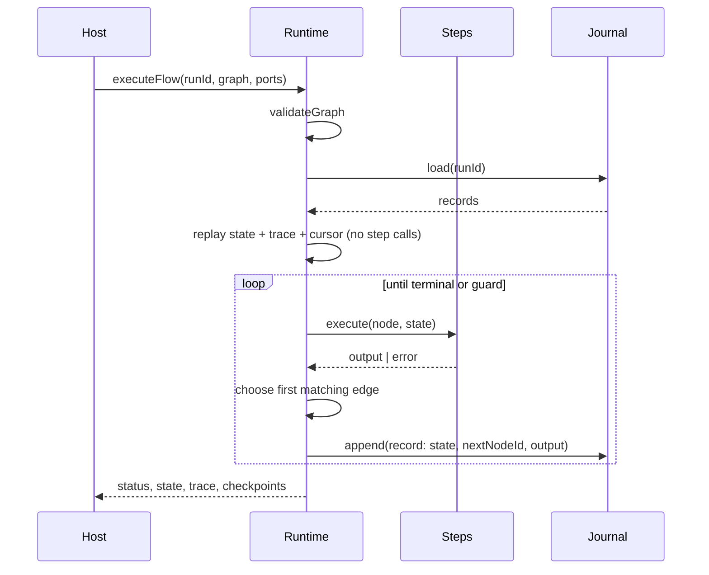

# Tartly Flow Runtime — the core artifact

**This repository's primary engineering artifact is a durable, deterministic
workflow runtime, not the email UI that consumes it.**

The runtime defines a small execution protocol — a guarded graph, a versioned
journal record, and replay semantics — and implements it in
[`packages/flow-runtime`](packages/flow-runtime). It is dependency-free
TypeScript with no imports from Next.js, React, Postgres, Redis, Zod, mail
providers, or authentication. The email operator is its **reference
application**: a production graph with 16 nodes, conditional branches, a send
gate, and best-effort steps that runs on the core every day.

```
packages/flow-runtime/     ← the reusable core (pure TypeScript)
lib/engine/                ← host adapters: step registry + Postgres journal
lib/email-operator/        ← reference application: inbound-email graph
```

## What makes it a runtime

A runtime owns execution semantics. This one owns five things an application
loop does not:

1. **Graph validation before side effects.** Duplicate node ids, edges that
   point nowhere, malformed configs, and guards without a field are rejected
   before the first step runs (`validateGraph`).
2. **Deterministic routing.** After every node the runtime scans edges in
   authored order and takes the first guard that passes. The same graph and
   state always produce the same next node (`selectNextEdge`).
3. **A durable journal, not a log.** Every node outcome appends a record with
   the post-node state, the chosen `nextNodeId`, timing, raw output, and whether
   the run continued. The record is committed **before** the next node starts.
4. **Resume and replay.** A new invocation loads the journal, rebuilds state and
   trace without invoking a single step, and continues at the recorded edge. A
   completed run is a no-op.
5. **Termination guarantees.** A per-run step ceiling and a repeated-node cycle
   guard stop runaway graphs before the offending node executes.

These are runtime semantics: an application that imports this package gets them
whether it is an email operator, a billing pipeline, or an incident workflow.

## Execution model



The journal is the source of truth. A crash can lose at most the single node in
flight; every completed node is already durable.

## Journal record

```ts
{
  format: "tartly.flow-runtime/1",
  seq: 4,                         // monotonic within the run
  nodeId: "egress",
  nodeType: "egress",
  status: "ok",
  ms: 38,
  at: "2026-10-31T12:00:00.000Z",
  output: { decision: "send", reason: "safe" },
  state: { trigger, category, draftId, decision, ... },
  nextNodeId: "x",                // the edge that was actually taken
  continued: true
}
```

Storing state **and** the routing decision is deliberate. Recomputing the next
edge from a changed graph could silently switch branches after a deploy. The
record preserves what the original run decided.

## Resume semantics

| Last journal entry | Next invocation |
| --- | --- |
| none | start at `nodes[0]` |
| `continued: true`, `nextNodeId: "x"` | continue at `x` |
| `continued: true`, `nextNodeId: null` | completed; return replayed result |
| `continued: false` (critical failure) | retry the failed node |

Legacy `{ nodeId, status, output }` records are still replayable: the runtime
merges successful plain-object outputs and re-evaluates the graph. Replay never
calls a step, so a resumed run cannot double-send, double-charge, or duplicate a
calendar event.

## Failure policy

- **`critical`** (default): record the failure, mark `continued: false`, stop,
  and return `status: "failed"`. Resume retries that node.
- **`best_effort`**: record the failure, keep state unchanged, follow the normal
  edge, and continue. The error remains in the trace and journal.

Unknown step types fail as `unknown_step`. Invalid config fails as `step_failed`
because parsing happens inside the node guard, not outside the runtime.

## Guards

| Guard | Default | Failure code |
| --- | --- | --- |
| Step ceiling (`maxSteps`) | 256, including replayed entries | `max_steps` |
| Cycle guard (`cyclePolicy`) | `fail` on a repeated node id | `cycle_detected` |
| Structural validation | always on | `invalid_graph` |
| Journal integrity | always on | `checkpoint_failed`, `resume_conflict` |

Intentional loops can opt into `cyclePolicy: "allow"`; the step ceiling still
bounds them.

## Ports

The core depends on two interfaces, both supplied by the host:

```ts
interface CheckpointStore {
  load(runId: string): Promise<readonly StoredCheckpoint[]>;
  append(runId: string, checkpoint: FlowCheckpointRecord): Promise<void>;
}

type StepResolver = (type: string) => StepAdapter | undefined;

interface StepAdapter<I, O> {
  type: string;
  policy?: "critical" | "best_effort";
  parseConfig(config: Record<string, unknown>): I;
  execute(ctx: {
    runId: string;
    nodeId: string;
    state: Readonly<Record<string, unknown>>;
    input: I;
    log: (event: string, data?: unknown) => void;
  }): Promise<O>;
}
```

The reference application implements them in
[`lib/engine/runtime-adapter.ts`](lib/engine/runtime-adapter.ts): a Postgres
journal over `flow_checkpoints` and an adapter over the registered steps.

## Reference application

The `inbound-email` graph is not a toy: triage → classify → load context →
sender intel → rules → commitments → meeting detection → slots → proposal →
draft → guardrails → egress → send → follow-up → memory → trace, with guarded
branches that skip drafting for FYI mail, skip slot-finding for non-meetings,
and route sends versus drafts. The `egress` node is the single send gate.

The application layer adds the things a runtime should not know about: OAuth
mailboxes, a Postgres job queue, idempotent send ledger, autopilot policy,
observability, and UI.

## Evidence

| Evidence | Path |
| --- | --- |
| Execution loop, replay, guards | `packages/flow-runtime/src/runtime.ts` |
| Graph validation and guards | `packages/flow-runtime/src/graph.ts` |
| Public contracts | `packages/flow-runtime/src/types.ts` |
| In-memory journal | `packages/flow-runtime/src/memory.ts` |
| Execution model | `packages/flow-runtime/SPEC.md` |
| App adapters | `lib/engine/runtime-adapter.ts` |
| Journal wire format | `lib/engine/checkpoint-codec.ts` |
| Reference graph | `lib/engine/flow.ts` |
| Host entry point | `lib/engine/run.ts` |
| Journal persistence | `lib/repositories/engine-persistence.ts` |
| Runtime unit suite (21 tests) | `tests/unit/engine/flow-runtime.test.ts` |
| Codec unit suite (5 tests) | `tests/unit/engine/checkpoint-codec.test.ts` |

Run the core suite and coverage:

```bash
npx vitest run tests/unit/engine/flow-runtime.test.ts
npx vitest run tests/unit/engine/flow-runtime.test.ts --coverage \
  --coverage.include='packages/flow-runtime/src/**/*.ts'
```

Current core coverage: **94.3% statements, 92.2% branches, 97.1% functions,
95.0% lines**.

## Why this is uncommon

Most AI email products ship a prompt plus a tool loop; the loop's progress lives
in process memory. This repository instead commits to runtime semantics:

- **Routing is recorded, not recomputed.** A resume follows the branch the
  original run took, even after a deploy changes guards.
- **Replay is side-effect free.** The journal rebuilds state and trace without
  calling a step, so a retry cannot duplicate a send or booking.
- **Failure is a policy, not an exception.** Critical steps stop and retry;
  best-effort steps record, continue, and remain visible in the trace.
- **Legacy journals remain readable.** The runtime upgrades old
  `{ nodeId, status, output }` rows during replay instead of stranding them.
- **The core boundary is tested.** A unit test reads the source tree and fails
  if the runtime imports Next.js, React, Drizzle, Postgres, Redis, or app code.

The email operator is the proof that these semantics survive a real product:
OAuth mailboxes, a Postgres queue, a send gate, and a 16-node graph.

## What is core vs. what is app

| Core (`packages/flow-runtime`) | Reference app (`lib/`) |
| --- | --- |
| Graph validation | The inbound-email graph content |
| Guarded edge selection | Which conditions the business wants |
| Journal schema and replay | Postgres persistence adapter |
| Critical vs. best-effort semantics | The actual step implementations |
| Resume cursor and cycle/step guards | Queue, cron, OAuth, UI, billing |

The distinction is enforced by imports: the core imports nothing from the app,
and the app consumes the core through `@tartly/flow-runtime`.
