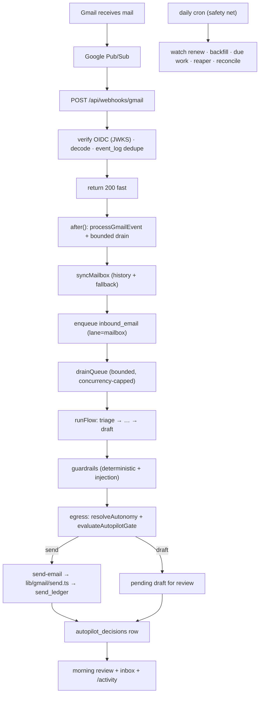

# PLAN — Tartly 24/7 Autopilot (Overnight Unattended Replies)

**Document ID:** `PLAN-24-7-autopilot` · **Version:** 2 (production-hardening) · **Status:** implemented
**Scope:** Gmail only · **Surface:** webhook → queue → engine → settings → inbox → agent → marketing
**Target:** Vercel-native (Hobby now, Pro later — config-only upgrade)
**Audience:** the engineer (human or agent) building this end to end.
**Supersedes:** v1 of this file.

> **Implementation note (2026-10-03):** all six phases below are implemented and
> green. Verified with `npm run test:unit` (128 + 32 autopilot tests),
> `npm run test:email-operator` (includes the new `phase-autopilot` harness) and
> `npm run openapi:check`. Migration `drizzle/0021_*` is additive. See
> `docs/changelog-entries/2026-10-03-24-7-autopilot.md` and `docs/runbooks/`.

> **Read `AGENTS.md` first.** This repo runs a modified **Next.js 16** — read the relevant guide in
> `node_modules/next/dist/docs/` before writing any route or `after()` code. When this doc and the
> code disagree, fix one in the same change.
>
> **Reference product:** `../../inbox-zero` (sibling repo). Borrowed patterns are marked
> **[ref: inbox-zero]** with the concrete Tartly equivalent named. Borrow patterns, not architecture.

---

## 0. How to use this document

An engineer or agent should be able to build from this without re-deriving decisions. It is organized
as:

1. **§1–2** Vision, guarantees, and the honest truth about "no faults".
2. **§3–4** Threat model (leaks/adversaries) and failure model (faults). Every later section maps to
   an entry here. If you add a feature that creates a new threat or failure, you must add an entry.
3. **§5–7** Baseline, gap register, invariants.
4. **§8–19** The design, subsystem by subsystem.
5. **§20–28** Production requirements: API, UI, observability, cost, config, migrations, testing,
   rollout, definition of done.
6. **§29** Appendices (matrices: gate reasons, error codes, event taxonomy, inbox-zero reference,
   glossary).

**Reading order for the implementer:** §5 → §6 → §7 → §8 (ship Phase 0 first) → §9 → §11 → §10 →
§14 → §12 → §20 → §21 → §22. Phases are in §25.

---

## 1. Vision and the 24/7 contract

Tartly's primary promise is: **your inbox is handled around the clock, even when the app is
closed — and you decide how much it may send without you.**

The 24/7 contract has three clauses. Each is independently testable:

| Clause | Meaning | Default |
|---|---|---|
| **C1 — Always processing** | Every inbound message is synced, triaged, and acted on server-side by push, without the user opening the app. | On for every connected mailbox |
| **C2 — Draft-first** | A reply is prepared and waits for approval. | On (`copilot`) |
| **C3 — Optional unattended send** | Inside a user-configured window and policy, safe replies auto-send; everything risky becomes a draft. | Off (`autopilot_policies.enabled = false`) |

### 1.1 Service objectives (SLOs)

These are the targets the build is judged against. They are deliberately modest enough to hold on
Vercel Hobby + serverless Postgres, and improve on Pro.

| # | Objective | Target | Measurement |
|---|---|---|---|
| SLO-1 | Push notification acknowledged | p99 < 1s | webhook latency histogram |
| SLO-2 | Inbound message processed (mirrored + triaged) | p95 < 60s, p99 < 5min | `event_log.created_at` → `flow_runs.finished_at` |
| SLO-3 | Overnight eligible reply auto-sent | p95 < 5 min after arrival | `messages.created_at` → `drafts.decided_at` |
| SLO-4 | Duplicate auto-sends | **0** | `send_ledger` uniqueness + reconciliation |
| SLO-5 | Auto-sends that violate policy | **0** | `autopilot_decisions` audit + evals |
| SLO-6 | Cross-user data exposure | **0** | authZ tests + query-scope lint |
| SLO-7 | Watch lapses unnoticed | **0** | watch-health alert < 24h to expiry |
| SLO-8 | Auto-send cost | 0 extra model calls | `ai_usage_events` by feature |

### 1.2 What is explicitly **not** promised

- Not "every email gets an automatic reply". The gate decides; most replies remain drafts.
- Not "zero faults". See §2.
- Not "instant". Serverless + provider latency means seconds to a few minutes (SLO-2/3).
- Not "human-quality judgment". It is bounded, auditable, and reversible.

---

## 2. The truth about "no faults / no leaks"

A senior engineer never claims zero faults. The credible commitment is **fail-safe, bounded blast
radius, detected, and recoverable**. Concretely, every subsystem in this plan must satisfy the
**Fault-Safety Contract**:

1. **Fail to draft.** Any error, ambiguity, missing input, timeout, or provider outage on the send
   decision resolves to `draft`, never `send`.
2. **Bounded blast radius.** One user's bad thread, one poisoned job, or one dead provider cannot
   block other users or drain the function past its budget.
3. **At-most-once side effects.** Sends and external actions are idempotent and reconciled.
4. **Detected.** Every silent failure has a counter, a log, a dashboard, or an alert.
5. **Recoverable.** Every automatic action has an audit row and a reversal path (draft/undo), and
   every stuck state has a reaper.
6. **Least privilege and least data.** New code requests no new OAuth scopes and stores/exposes no
   message content it does not need.

Any PR that violates a clause is rejected in review. §3 and §4 are the enumerated threats/faults this
contract is written against.

---

## 3. Threat model (leaks, adversaries, abuse)

Legend: **P** = priority (P0 = must ship with the feature, P1 = ship before GA, P2 = post-GA).

| ID | Threat / leak | Impact | Control | Priority | Test |
|---|---|---|---|---|---|
| T-01 | Forged Gmail Pub/Sub push drives processing | Cross-tenant abuse, DoS | OIDC/JWKS verification already fails closed (`verifyGoogleOidcToken`); audience + issuer + expiry + RS256 | P0 | forged/malformed/expired token tests |
| T-02 | Webhook replay | Duplicate work / sends | `event_log (user_id, external_id)` unique + `job_queue.source_event_id` + `send_ledger` | P0 | replay test asserts one send |
| T-03 | Unauthenticated cron trigger | Data mutation / cost | `isCronAuthorized` constant-time, fails closed when secret unset | P0 | missing/wrong/empty secret tests |
| T-04 | IDOR on new autopilot routes | Cross-user data leak/mutation | All routes use `withUser`; repository `findByIdForUser`; never trust body/query `userId` | P0 | cross-user route tests |
| T-05 | Prompt injection in email drives an auto-send | Fraud, data exfiltration | Injection classifier + prompt hardening + `forcedDraft`; the gate never sends on model instruction alone; commitment/auto-responder checks | P0 | injection corpus evals |
| T-06 | PII/message content leaks into logs, traces, or `autopilot_decisions` | Privacy breach | Never log bodies/tokens; decision rows store reason + category + confidence only, never body; logger redaction | P0 | log-scan test; schema review |
| T-07 | OAuth token leakage/refresh bug | Full mailbox compromise | Tokens stay in Better Auth `account`; access via existing helper only; no new scopes; errors never echo tokens | P0 | token-not-logged test |
| T-08 | Auto-responder loop / ping-pong | Spam amplification, cost | `auto_responder` guardrail + loop threshold + per-thread cap | P0 | loop fixture test |
| T-09 | Compromised mailbox mass-send via autopilot | Abuse, deliverability | Caps (hour/day/thread), global env ceiling, anomaly alerts, instant kill switch | P0 | cap boundary tests |
| T-10 | SSRF via preview/webhook/URL handling | Internal network access | Preview is first-party only; no user-supplied URLs fetched; existing web research path unchanged | P1 | route allows no URL input |
| T-11 | Oversized/malformed request body | Memory/DoS | `withUser` `Content-Length` cap + Zod validation | P0 | 413 test |
| T-12 | Brute-force on settings routes | Data mutation | `withUser` per-user rate limit | P0 | 429 test |
| T-13 | Cross-user job execution | Data leak | Jobs carry `user_id`; handlers re-check ownership (`mailboxes.userId = job.userId`) | P0 | handler ownership test |
| T-14 | Malicious category/allowlist input | Unexpected sends | Zod enums + server-side clamp to env ceilings; ignore unknown categories | P0 | validation tests |
| T-15 | Secret in client bundle | Credential leak | New vars server-only unless `NEXT_PUBLIC_`; env validated in `lib/env.ts` | P0 | build scan |
| T-16 | Denial of wallet (model/send storm) | Cost | Existing AI budget + global budget + new send caps; heuristics-first | P1 | budget exhaustion test |
| T-17 | Data retention beyond need | Compliance | Documented retention for `autopilot_decisions`/`event_log`/`messages`; cascade on user delete | P1 | retention job test |
| T-18 | Unauthorized kill-switch bypass (client-only flag) | Unwanted sends | Every gate is server-side; UI is display only | P0 | UI cannot force a send |
| T-19 | Spoofed `From`/`Reply-To` | Mis-reply | Reply to the inbound `From` from the stored message; never trust body-declared addresses | P0 | header-spoof test |
| T-20 | Attachment/malware propagation | Harm | v1 auto-replies never attach user assets to unattended sends (text only) | P0 | send-email config review |

### 3.1 Security posture derived from the threats

- **Defense in depth for sends:** OIDC → event dedupe → ownership check → policy gate → guardrails →
  `egress` → `send-email` ledger. No single layer is load-bearing alone.
- **No new OAuth scopes.** Keep `gmail.modify` + `gmail.send` only (avoids the CASA-heavy
  `mail.google.com` scope), matching the existing app.
- **Server is the only authority.** A client cannot enable a send the gate would refuse.
- **Audit without content.** `autopilot_decisions` is deliberately content-free.

---

## 4. Failure model (faults and recovery)

Legend: **D** = detection, **M** = mitigation, **R** = recovery. All P0 faults must have D/M/R before
GA.

| ID | Fault | D | M | R |
|---|---|---|---|---|
| F-01 | Webhook enqueues but nothing drains (today's bug) | no `inbound_email` run within SLO-2 | bounded `drainQueue` inside webhook `after()` | daily safety net + manual "Sync now" |
| F-02 | Webhook invocation times out mid-drain | drain logs incomplete batch; jobs stay `running` | bounded batch; per-job try/catch | reaper revives after visibility timeout |
| F-03 | Pub/Sub redelivery / duplicate notification | `event_log` dedupe counter | unique constraints | idempotent handlers |
| F-04 | Gmail `history.list` cursor expired/truncated | sync falls back to recent listing (already) | fallback + log | next sync catches up |
| F-05 | Out-of-order / rapid multiple inbound in one thread | lane serialization | `laneKey = mailbox:<id>` + one pending draft per thread | next run reconciles |
| F-06 | Watch expired / watch API failure | watch-health query | renewal in daily cron | reaper + alert |
| F-07 | Model provider down/429 | circuit breaker + fallback chain | deterministic fallback draft; gate fails to draft | retry next run |
| F-08 | Global/user AI budget exhausted | budget counter | heuristics / skip background call | resets at UTC day |
| F-09 | Postgres pool exhaustion (serverless) | connection errors | small `DB_POOL_MAX`; pooled endpoint | backoff + retry; bounded batches |
| F-10 | Redis (Upstash) unavailable | lock/cache errors | locks fail open; idempotency proceeds uninstrumented; DB remains source of truth | self-heals |
| F-11 | Poison job (always throws) | `job_queue.last_error` + attempts | backoff → `dead` | DLQ inspection + manual requeue |
| F-12 | Cron double-fire | event/dedupe counters | idempotency keys | none needed |
| F-13 | Draft regenerated after an `autopilot_decisions` row | audit mismatch | decision references `draftId`; regen updates the pending draft, decision stays as historical fact | "Why?" shows latest + history |
| F-14 | Send succeeds but DB write fails | ledger vs mailbox mismatch | `send_ledger` written before/with send; reconciliation job | reconcile from Gmail |
| F-15 | Timezone/DST window bug | wrong-time send | reuse `lib/calendar/tz.ts`; window math unit-tested across DST | policy affected only |
| F-16 | Mailbox disconnects mid-window | auth error | `gmailFetch` 401/403 → mark reconnect needed; gate drafts | user reconnects |
| F-17 | Loop / auto-responder ping-pong | loop counter | `auto_responder` + loop threshold | drafts, then human |
| F-18 | Send cap race (two concurrent runs) | counter drift | per-lane serialization + counters read in the same run | next run re-reads |
| F-19 | Unexpected category/confidence null | gate check fails | **null ⇒ draft** (explicit) | reason recorded |
| F-20 | User turns policy off while a run is in flight | next message refreshes | gate re-reads policy each run | effective immediately |

### 4.1 Fault-injection requirements

The test suite (§27) must actively simulate F-01, F-02, F-03, F-07, F-08, F-10, F-11, F-14, F-18,
F-19 — not just assert the happy path. "It works when nothing goes wrong" is not a test.

---

## 5. Baseline — what already exists (verified in code)

> Do not rebuild any of this. Extend it.

| Area | What exists | Key files |
|---|---|---|
| Inbound push | OIDC/JWKS verification (fail closed), payload decode, `event_log` dedupe, `after()` process | `app/api/webhooks/gmail/route.ts`, `lib/gmail/pubsub.ts`, `lib/email-operator/events.ts` |
| Watch | `users.watch` + `watch_expiration`; renewed in daily cron | `lib/gmail/watch.ts`, `lib/email-operator/cron.ts` |
| Sync | `history.list` incremental with recent-list fallback; idempotent upsert; monotonic `lastMessageAt` | `lib/gmail/sync.ts` |
| Queue | `enqueue`/`claim` (`FOR UPDATE SKIP LOCKED`)/`complete`/`fail`/`cancel`/`reap`; lane uniqueness; global concurrency; advisory lock | `lib/queue/queue.ts` |
| Drain | Bounded `drainQueue`; Redis-locked opportunistic `kickDrain` | `lib/email-operator/drain.ts` |
| Engine | Steps → flow → run; checkpoints; `critical` vs `best_effort`; trace | `lib/engine/{step,flow,run,registry}.ts` |
| Inbound flow | 16 nodes incl. `guardrails`, `egress`, `send-email`, `update-memory` | `lib/engine/flow.ts` |
| Send gate | `egress` reads autonomy; `send-email` re-checks + `send_ledger`; only automation caller of `sendEmail` | `lib/engine/steps/{egress,send-email}.ts`, `lib/gmail/send.ts` |
| Autonomy | thread > contact > mailbox > `copilot`; set/get; scoped UI | `lib/settings/autonomy.ts`, `components/assistant/{mailbox,scoped}-autonomy.tsx` |
| Guardrails | Forbidden phrases, ungrounded numbers/deadlines, prompt-injection classifier, length → `forcedDraft` | `lib/engine/steps/guardrails.ts`, `lib/guardrails/injection.ts` |
| Drafts | One pending per thread; `status`, `confidence`, `suppressed`, `sentBy`, `pipelineVersion` | `lib/engine/steps/draft-reply.ts`, `lib/db/schema.ts` |
| Inbox | 6-bucket precedence (counts == lists); `ai_handled` | `lib/inbox/service.ts` |
| Morning briefing | `buildBriefing` + catch-up popup | `lib/briefing/*`, `docs/plans/morning-briefing.md` |
| AI gateway | `generateObject/Text/stream` with roles, fallback chain, circuit breaker, budget, usage ledger, hardening, timeout | `lib/ai/generate.ts`, `lib/ai/{budget,circuit-breaker,model-chain,usage,prompts}.ts` |
| API wrapper | `withUser` (auth, rate limit, idempotency, request context, body cap, error envelope) | `lib/api/http.ts`, `lib/api/idempotency.ts` |
| Cron auth | Constant-time, fails closed | `lib/email-operator/cron-auth.ts` |
| Repositories | User-scoped `findByIdForUser` pattern | `lib/repositories/*` |
| Follow-up rules | Unreachable-address list; quiet-hours/weekend via `lib/calendar/tz.ts` | `lib/followup/rules.ts` |
| Env | Zod-validated, feature-gated | `lib/env.ts`, `.env.example` |
| Crons | Only `/api/v1/cron/daily` scheduled; `drain`/`followups` routes exist for Pro | `vercel.json`, `app/api/v1/cron/*` |

**Critical existing invariant:** on the automation path, only `send-email` calls
`lib/gmail/send.ts`. Manual `approveDraft` is the only other sender. New automatic sends must be
expressed as an `egress` outcome.

---

## 6. Gap register

Severity: **S0** = breaks the 24/7 promise; **S1** = unsafe/untrustworthy; **S2** = missing
control/observability.

| ID | Gap | Sev | Fix | Phase |
|---|---|---|---|---|
| G-01 | Webhook enqueues but never drains | **S0** | bounded drain in webhook `after()` | P0 |
| G-02 | Watch can lapse silently | S1 | `getUnhealthyWatches` + health alert/reaper | P0 |
| G-03 | Autonomy is always-on/static; no send window | S1 | `autopilot_policies` + window math | P1 |
| G-04 | No risk policy (confidence/known-sender/category) | S1 | `evaluateAutopilotGate` | P1 |
| G-05 | No loop / auto-responder protection | **S1** | guardrail checks + loop threshold | P2 |
| G-06 | No commitment/price/date block for auto-send | **S1** | `commitment_language` guardrail | P2 |
| G-07 | No send caps | S1 | policy caps + usage counters | P1/P2 |
| G-08 | No decision audit | S2 | `autopilot_decisions` (content-free) | P1 |
| G-09 | No opt-in surface / kill switch | S1 | `/settings/autopilot` + `/pause` | P4 |
| G-10 | No morning review of overnight activity | S2 | briefing overnight section | P3 |
| G-11 | No reconciliation for send/DB drift | S2 | reconcile job | P2 |
| G-12 | Marketing over-claims | S2 | copy update + `PRODUCT.md` | P5 |
| G-13 | No load/chaos tests for the overnight path | S2 | harness + fault injection | P1–P5 |
| G-14 | `autopilot_decisions` has no retention | S2 | retention job + doc | P5 |

---

## 7. Invariants (testable laws)

Every invariant has an ID and a test. A change that can violate one must update the test in the same
PR.

| ID | Invariant |
|---|---|
| INV-01 | In `copilot`, zero automatic sends occur (drafts only). |
| INV-02 | An automatic send happens only if `egress` returned `decision="send"` in the same run. |
| INV-03 | An automatic send happens only if `autopilot_policies.enabled = true` **and** global `AUTOPILOT_ENABLED ≠ "false"`. |
| INV-04 | An automatic send never occurs outside the configured window (mode `window`). |
| INV-05 | Any guardrail violation forces a draft. |
| INV-06 | `null` category, `null` confidence, or unknown sender ⇒ draft. |
| INV-07 | Two concurrent runs for the same `laneKey` cannot both send. |
| INV-08 | A redelivered event or double-fired drain sends at most once (`send_ledger`). |
| INV-09 | No new OAuth scope is requested by this feature. |
| INV-10 | Every query touching user data is scoped by `user_id` (repositories / explicit predicate). |
| INV-11 | `autopilot_decisions` never stores message bodies or tokens. |
| INV-12 | No cron/webhook route mutates state before auth passes. |
| INV-13 | Disabling the policy takes effect on the next processed message. |
| INV-14 | A failing thread/job cannot prevent other users' jobs from running (isolation). |
| INV-15 | The gate adds zero model calls per evaluation. |

---

## 8. Architecture and the overnight sequence



### 8.1 Overnight timeline (the exact behavior we sell)

| Time | Event | System action |
|---|---|---|
| 02:13 | Email arrives | Pub/Sub push → OIDC verify → `event_log` → 200 |
| 02:13 | same invocation `after()` | `syncMailbox` mirrors it; `inbound_email` enqueued; `drainQueue` runs it |
| 02:13–02:18 | Flow runs | triage, sender-intel, rules, commitments, draft-reply, guardrails |
| 02:18 | `egress` | autonomy `autopilot` + window active + all gate checks pass ⇒ `send` |
| 02:18 | Send | `send-email` → `gmail.send` with ledger key; mirror outbound; draft `sentBy="ai"` |
| 02:18 | Audit | `autopilot_decisions(decision="send", reason="autopilot", …)` |
| 07:30 | User opens app | catch-up shows "Overnight: 3 sent, 2 drafted, 1 held — here's why" |

If any condition fails at 02:18, the message becomes a draft with a machine reason, and the morning
review explains it.

### 8.2 Trigger priority (unchanged philosophy)

1. **Push + inline drain (primary).** Real-time, server-side, no app needed.
2. **Pro cron drain (every minute).** Latency backstop and safety net.
3. **Hobby daily cron.** Watch renew, backfill, due commitments/follow-ups, reaper, reconcile.
4. **Opportunistic `kickDrain`.** On authenticated requests (belt-and-braces; never the only path).

---

## 9. Inbound reliability subsystem

### 9.1 Webhook (fix G-01)

**File:** `app/api/webhooks/gmail/route.ts`.

Keep the fast-ack contract. Add the bounded drain inside the existing `after()`:

```ts
if (isNew) {
  after(async () => {
    try {
      await processGmailEvent(id);
      await drainQueue({
        workerId: `webhook:${id}:${Date.now().toString(36)}`,
        batchSize: webhookDrainBatchSize(), // env WEBHOOK_DRAIN_BATCH_SIZE, default 5, clamp ≤ QUEUE_MAX_CONCURRENCY
      });
    } catch (error) {
      console.error("[webhooks/gmail] processing failed", error);
    }
  });
}
```

**[ref: inbox-zero]** inbox-zero acknowledges the Pub/Sub message immediately and processes via
`after(...)` in `/api/google/webhook`, and it skips enqueue when the provider is rate-limited. Tartly
should adopt the same **rate-limit guard**: if Gmail returns a rate-limit signal mid-sync, do not
hammer; leave the job pending for the next drain. Add a `getEmailProviderRateLimitState`-equivalent
only if measurements show quota pressure; otherwise rely on Gmail 429 handling in `gmailFetch`.

**Requirements:**
- Never drain synchronously before returning (Pub/Sub ack timeout risk).
- Never let a drain error change the 200 ack.
- `maxDuration = 300` stays.
- The drain is bounded by both `batchSize` and the queue's global `maxConcurrency`.

### 9.2 History sync hardening

**File:** `lib/gmail/sync.ts`.

- Current fallback (expired cursor → recent list) is correct; keep it. Add: when `history.list`
  returns a `nextPageToken`, page through (bounded, e.g. ≤ 5 pages per drain) rather than silently
  stopping at 100. Record `historyPageCount` for detection.
- Store `lastSyncedAt` and a `syncError` marker (additive column) so the watch-health panel can show
  "last sync failed".
- If `historyId` is missing entirely, fetch profile cursor after the recent listing (already done).

### 9.3 Watch health (fix G-02)

**File:** `lib/gmail/watch.ts`, `lib/email-operator/cron.ts`.

- `getUnhealthyWatches({ now, minMinutesLeft = 1440 })` → mailboxes with null or soon-expiring
  `watch_expiration`.
- Renew these first in `runDailyMaintenance`; expose `watchesRenewed`, `watchesFailed`.
- Add a `mailbox.watchStatus` derivation (`ok | expiring | lapsed`) to the operator panel.
- On Pro, a dedicated watch-renew cron may run more often (config only).

### 9.4 Queue hardening

**File:** `lib/queue/queue.ts`, `lib/email-operator/drain.ts`.

- **Poison/DLQ:** jobs that exhaust `max_attempts` become `dead` (exists). Add a `dead` count metric
  and an admin requeue path (a script, not a public route). §22 observability.
- **Fairness:** the lane key serializes per mailbox/thread. For burst fairness across users, the
  claim SQL already orders by priority then `run_after`; keep it. Do not add cross-user starvation by
  a single mailbox's backlog — the drain batch is small and the daily cron fans out.
- **Backpressure:** if `msUntilNextJob` returns null, nothing to do; do not spin.
- **Visibility timeout:** default 5 min; the reaper is idempotent. Keep.
- **Per-job isolation:** the drain wraps each handler in try/catch (exists). Ensure a thrown handler
  cannot abort the loop.

### 9.5 Timeouts and resumability

Serverless functions are bounded. Rules:

- Each drain processes ≤ `batchSize` jobs; each handler is bounded internally (existing handlers cap
  threads at `MAX_THREADS_PER_RUN = 5`).
- `generateObject` has a per-call timeout (20s default) and a fallback.
- Anything unfinished remains `pending`/`running` and is resumed by the reaper or the next cron.
- **No long-lived workers, ever.**

---

## 10. Autopilot policy engine

### 10.1 Model and precedence

```
Effective automatic-send = global gate
  AND mailbox/contact/thread autonomy == "autopilot"
  AND autopilot_policies.enabled
  AND policy checks (window, confidence, sender, category, caps, loop)
  AND no guardrail violation
```

Precedence for **autonomy** stays `thread_settings.autonomy > contacts.autonomyOverride >
mailboxes.autonomy > copilot` (`resolveAutonomy`). The **policy** is mailbox-scoped in v1; per-contact
and per-thread can be added later as overrides without schema change (nullable columns), but v1 keeps
it simple.

> **Design decision:** if autonomy is `copilot` at any more-specific scope, the gate drafts even if
> the mailbox policy is on. This preserves the existing "both directions" override semantics.

### 10.2 New module `lib/settings/autopilot.ts`

```ts
export type AutopilotMode = "window" | "always";
export const AUTOPILOT_POLICY_VERSION = 1;

export type AutopilotPolicy = {
  id: string;
  enabled: boolean;
  mode: AutopilotMode;
  timezone: string;
  days: number[];                 // ISO 1..7
  windowStartHour: number;        // 0..23
  windowEndHour: number;          // 0..23, wrap allowed
  minConfidence: "HIGH" | "MEDIUM" | "LOW";
  requireKnownSender: boolean;
  allowedCategories: string[];
  maxPerHour: number;
  maxPerDay: number;
  maxPerThread: number;
  loopThreshold: number;
  morningReview: boolean;
  policyVersion: number;
};

export async function getAutopilotPolicy(userId: string): Promise<AutopilotPolicy>;
export async function setAutopilotPolicy(userId: string, patch: Partial<AutopilotPolicy>): Promise<AutopilotPolicy>;
export function isWithinSendWindow(now: Date, policy: AutopilotPolicy): boolean;
export function evaluateAutopilotGate(input: AutopilotGateInput): AutopilotGateResult;
export async function isKnownSender({ userId, email }: { userId: string; email: string | null }): Promise<boolean>;
```

`isWithinSendWindow` **must** use `lib/calendar/tz.ts` (`getZonedParts`, `getIsoWeekday`) exactly as
`lib/followup/rules.ts` does. Do not re-implement timezone math. Wrap windows (e.g. `22 → 7`) are
supported; `days` is evaluated against the **local** weekday at `now`.

### 10.3 The pure gate

```ts
export type AutopilotGateInput = {
  now: Date;
  policy: AutopilotPolicy;
  globalEnabled: boolean;
  category: string | null;
  confidence: "HIGH" | "MEDIUM" | "LOW" | null;
  contactEmail: string | null;
  knownSender: boolean;
  guardrailViolations: string[];   // from the guardrails step
  sentLastHour: number;
  sentLastDay: number;
  sentInThread: number;
  consecutiveAutomatedExchanges: number;
};

export type AutopilotGateResult = {
  allowed: boolean;
  reason: AutopilotGateReason;
  checks: Record<string, boolean>;
};
```

**Evaluation order (first failure wins; order is part of the contract and is unit-tested):**

| # | Check | Fail reason |
|---|---|---|
| 1 | `globalEnabled` | `autopilot_disabled_globally` |
| 2 | `policy.enabled` | `autopilot_disabled` |
| 3 | `mode === "always"` or inside window | `outside_window` |
| 4 | `guardrailViolations.length === 0` | the first violation, e.g. `guardrails:commitment_language` |
| 5 | `confidence != null && >= minConfidence` | `low_confidence` |
| 6 | `category != null && allowedCategories.includes(category)` | `category_not_allowed` |
| 7 | `!requireKnownSender || knownSender` | `unknown_sender` |
| 8 | `sentLastHour < maxPerHour` | `hour_cap` |
| 9 | `sentLastDay < maxPerDay` | `day_cap` |
| 10 | `sentInThread < maxPerThread` | `thread_cap` |
| 11 | `consecutiveAutomatedExchanges < loopThreshold` | `loop_detected` |
| — | all pass | `autopilot` |

**Null handling is a hard rule:** `confidence === null` or `category === null` fails at #5/#6. Never
treat unknown as eligible.

### 10.4 Gate reason → user copy (single source of truth)

Maintain a `AUTOPILOT_REASON_LABELS` map used by the API, the thread "Why?" popover, and the morning
review. Appendix A lists them all. Never surface a raw enum to users.

### 10.5 Usage counters

`lib/settings/autopilot-usage.ts`:

- `sentLastHour`, `sentLastDay`: `count(*)` from `drafts` where `user_id = ? and sent_by = 'ai' and
  decided_at >= now() - interval`. Backed by a new index (§11.4).
- `sentInThread`: same filtered by `thread_id`.
- `consecutiveAutomatedExchanges`: count trailing `drafts.sentBy='ai'` in the thread since the last
  human-driven message. Implement with a bounded query (most recent `loopThreshold + 2` messages
  joined to drafts). Cheap and deterministic.
- `recordAutopilotDecision(...)`: one insert, best-effort (never changes the decision).

> **Simplification option (only if profiling demands):** maintain Redis counters keyed by
> `autopilot:<userId>:<hour|day|thread>`. **Do not** start here — Redis is a speed layer and must
> not be the source of truth. Postgres counts are correct under concurrency via lane serialization.

### 10.6 Egress integration

**File:** `lib/engine/steps/egress.ts`. Keep the existing `copilot` path byte-for-byte. Only when
`autonomy === "autopilot"`:

1. Read policy + usage + `knownSender` + `guardrailViolations` (from `ctx.state`).
2. Call `evaluateAutopilotGate`.
3. `decision = allowed ? "send" : "draft"`; `reason = gate.reason`.
4. `recordAutopilotDecision` (best-effort, content-free).
5. Return the same shape egress already returns, plus `autopilotReason`.

No new flow node is required, so existing seeded graphs pick up the behavior with **no graph
migration**. If a node is added for readability, bump `INBOUND_EMAIL_FLOW_VERSION` and rely on
`seedDefaultFlows` refresh.

### 10.7 `knownSender`

One indexed query against `contacts (user_id, email)`; fall back to a prior outbound message in the
mirror. Prefer an existing repository method (`lib/repositories/contacts.ts`). Cache within a run via
`ctx.state` only if profiling shows need.

---

## 11. Data model

Edit `lib/db/schema.ts` → `npm run db:generate` → commit SQL → `npm run db:migrate`. Every
user-owned table: `user_id` FK + index starting with `user_id`.

### 11.1 `autopilot_policies`

```ts
export const autopilotPolicies = pgTable(
  "autopilot_policies",
  {
    id: text("id").primaryKey(),
    userId: text("user_id").notNull().references(() => user.id, { onDelete: "cascade" }),
    mailboxId: text("mailbox_id").notNull().references(() => mailboxes.id, { onDelete: "cascade" }),
    enabled: boolean("enabled").notNull().default(false),          // opt-in
    mode: text("mode").notNull().default("window"),                // "window" | "always"
    timezone: text("timezone").notNull().default("UTC"),
    days: jsonb("days").$type<number[]>().notNull().default([1,2,3,4,5,6,7]),
    windowStartHour: integer("window_start_hour").notNull().default(22),
    windowEndHour: integer("window_end_hour").notNull().default(7),
    minConfidence: text("min_confidence").notNull().default("HIGH"),
    requireKnownSender: boolean("require_known_sender").notNull().default(true),
    allowedCategories: jsonb("allowed_categories").$type<string[]>().notNull().default(["needs_reply"]),
    maxPerHour: integer("max_per_hour").notNull().default(10),
    maxPerDay: integer("max_per_day").notNull().default(50),
    maxPerThread: integer("max_per_thread").notNull().default(3),
    loopThreshold: integer("loop_threshold").notNull().default(3),
    morningReview: boolean("morning_review").notNull().default(true),
    policyVersion: integer("policy_version").notNull().default(1),
    createdAt: timestamp("created_at", { withTimezone: true }).defaultNow().notNull(),
    updatedAt: timestamp("updated_at", { withTimezone: true }).defaultNow().$onUpdate(() => new Date()).notNull(),
  },
  (t) => [
    uniqueIndex("autopilot_policies_mailbox_unique").on(t.mailboxId),
    index("autopilot_policies_user_idx").on(t.userId),
  ],
);
```

### 11.2 `autopilot_decisions` (content-free audit)

```ts
export const autopilotDecisions = pgTable(
  "autopilot_decisions",
  {
    id: text("id").primaryKey(),
    userId: text("user_id").notNull().references(() => user.id, { onDelete: "cascade" }),
    mailboxId: text("mailbox_id").notNull().references(() => mailboxes.id, { onDelete: "cascade" }),
    threadId: text("thread_id").references(() => threads.id, { onDelete: "set null" }),
    runId: text("run_id").references(() => flowRuns.id, { onDelete: "set null" }),
    draftId: text("draft_id").references(() => drafts.id, { onDelete: "set null" }),
    contactEmail: text("contact_email"),
    decision: text("decision").notNull(),               // "send" | "draft"
    reason: text("reason").notNull(),
    autonomySource: text("autonomy_source"),            // thread | contact | mailbox
    category: text("category"),
    confidence: text("confidence"),
    checks: jsonb("checks").$type<Record<string, boolean>>(),   // NO body, NO subject, NO tokens
    policyVersion: integer("policy_version").notNull().default(1),
    createdAt: timestamp("created_at", { withTimezone: true }).defaultNow().notNull(),
  },
  (t) => [
    index("autopilot_decisions_user_created_idx").on(t.userId, t.createdAt),
    index("autopilot_decisions_thread_idx").on(t.threadId, t.createdAt),
  ],
);
```

> **Leak control (T-06 / INV-11):** this table must never contain `subject`, `body`, or contact
> names. Store IDs only; the UI joins to `threads` for display, scoped by `user_id`.

### 11.3 `assistant_settings` additive columns

```ts
overnightReviewEnabled: boolean("overnight_review_enabled").notNull().default(true),
overnightReviewLastAt: timestamp("overnight_review_last_at", { withTimezone: true }),
```

### 11.4 Index for cap counting

```
index("drafts_user_sentby_decided_idx").on(drafts.userId, drafts.sentBy, drafts.decidedAt)
```

### 11.5 Optional additive column: `mailboxes.syncError`

```ts
syncError: text("sync_error"),   // short, no content — for watch/sync health UI
```

### 11.6 Retention & deletion

| Table | Retention | Mechanism |
|---|---|---|
| `autopilot_decisions` | 90 days (configurable) | `cron/daily` prune |
| `event_log` | existing policy; add prune if absent | `cron/daily` |
| `messages`/`threads` | mirror of Gmail; delete cascade on mailbox/user delete | FK cascade |
| `send_ledger` | keep (idempotency history); prune only beyond a safe window | `cron/daily` |

On user deletion, cascades remove policies, decisions, drafts, threads, messages. Verify with a test.
Export/delete must satisfy the privacy policy; document in §23.

---

## 12. Concurrency, idempotency, consistency

This is where "no faults" is actually earned. Enumerate and protect every race.

### 12.1 Keys and uniqueness

| Effect | Key | Guarantee |
|---|---|---|
| Inbound provider event | `event_log (user_id, external_id)` unique | one processing per notification |
| Event → job | `job_queue.source_event_id` unique per user | one job per event |
| Run → send | `send_ledger.idempotency_key` unique | one send per run/action |
| Manual approval | `draft:<draftId>` ledger key | one send per draft |
| Commitment nudge | `commitment:<id>:<nudgeCount>` | one nudge per stage |
| Autopilot decision | one row per `egress` evaluation | audit completeness |

### 12.2 Races and resolutions

| Race | Resolution |
|---|---|
| Two webhook invocations for the same mailbox | Both `after()` drains run; `claimJobs` + lane uniqueness ⇒ one job at a time; the second finds nothing or a different lane. |
| Two inbound messages in one thread concurrently | Same `laneKey`; only one `running` per lane; processed sequentially. The later run re-reads the latest inbound. |
| Policy updated mid-run | Gate reads policy at evaluation time; next message reflects the change (INV-13). |
| Cap boundary hit twice | Lane serialization means usage is read then acted within one run; the next run re-reads. |
| Draft regenerated after a decision | Decision keeps `draftId`; UI shows the latest draft + decision history. Historical facts are immutable. |
| Send succeeds, DB write fails | `send_ledger` key prevents a re-send; reconciliation (§12.3) repairs the mirror. |
| Cron double-fires | Dedupe keys make it idempotent. |

### 12.3 Reconciliation job

**New:** `lib/email-operator/reconcile.ts`, invoked by `cron/daily` and the Pro drain.

- Find `send_ledger` rows with `status="sent"` but no matching outbound `messages` row → insert the
  mirror row (or mark needs-attention if the Gmail message cannot be found).
- Find `drafts` `status="pending"` whose thread received a newer inbound → the next flow run
  regenerates; optionally mark stale.
- Find `job_queue` rows `running` past the visibility timeout → handled by `reapExpiredJobs`.
- Emit counts to `/activity`.

### 12.4 Transactions

- `completeJob` supports an `inSameCommit` callback — use it for any DB write that must be atomic
  with job completion (existing pattern; preserve it).
- Keep the send path: claim ledger → send → record mirror → mark draft sent. The ledger key makes a
  partial failure safe to retry.

---

## 13. Guardrails and content safety

**File:** `lib/engine/steps/guardrails.ts`.

Extend `GUARDRAIL_CHECKS` with deterministic, content-risk checks. These are **risk patterns**, not
an English-wording blacklist to patch model output (house rule), so they are appropriate.

### 13.1 `commitment_language` (G-06)

Flag drafts that imply a promise, price, legal term, or a hard date not present in the grounding
corpus:

- Money: `$`, `€`, `£`, `\b(price|pricing|cost|fee|invoice|discount|refund|contract|terms)\b`
- Commitment verbs combined with a deadline token (reuse `DEADLINE_PATTERN`) or with
  `\b(commit|guarantee|promise|sign|purchase|pay)\b`
- Legal: `\b(legally|agreement|nda|liable|liability)\b`

If matched and not grounded in the inbound/history ⇒ violation ⇒ `forcedDraft`.

### 13.2 `auto_responder` (G-05 / T-08)

Never auto-reply to robots/bounces/out-of-office/lists:

- Local part in the `UNREACHABLE_LOCAL_PARTS` list (`lib/followup/rules.ts`): `no-reply`, `noreply`,
  `mailer-daemon`, `postmaster`, `bounce`, `notifications`, `donotreply`, …
- Headers: `Auto-Submitted: auto-replied|auto-generated`, `X-Autoreply`, `Precedence: bulk|junk`
- Subject prefixes: `Auto:`, `Out of Office`, `Automatic reply`, `Vacation`, `Undeliverable`
- Bulk signals: `List-Id` / `List-Unsubscribe` present

**Implementation note:** the guardrails step currently sees `latestMessage`, `history`, and
`contact`. Extend `load-context` (additive) to carry the few headers needed (`autoSubmitted`,
`precedence`, `listId`, `listUnsubscribe`) into state. Do not fetch full bodies for this.

### 13.3 Injection (existing) as defense in depth

`classifyPromptInjection` already forces a draft. Keep it; add the rule that **retrieved content
never authorizes a side effect**. The gate only sends on deterministic checks + draft content that
passes guardrails.

### 13.4 Confidence (existing)

`draft-reply` already returns `confidence` and respects `draftConfidence`. The gate uses the raw
model `confidence` (not the suppressed flag) and requires `>= minConfidence`. A deterministic
fallback draft has `confidence = null` ⇒ gate drafts (INV-06).

---

## 14. Caps, budgets, abuse prevention

### 14.1 Caps (G-07 / T-09)

- Per-hour, per-day, per-thread enforced by the gate.
- Env ceilings clamp user input: `AUTOPILOT_MAX_PER_HOUR`, `AUTOPILOT_MAX_PER_DAY`.
- Defaults conservative (≤50/day) — well inside a personal Gmail quota.
- Include **all** automated sends in counts (`drafts.sentBy='ai'`), not only replies.

### 14.2 Cost (T-16)

- The gate adds zero model calls (INV-15).
- All model calls already go through `lib/ai/generate.ts` with per-user budget, global budget,
  circuit breaker, and fallback.
- Auto-send path uses only `draft-reply` (already budgeted) and deterministic checks.

### 14.3 Abuse / compromised mailbox

- Caps bound damage.
- Alert when `hour_cap`/`day_cap` is hit repeatedly (possible storm or compromise).
- The kill switch (`enabled=false`) and global `AUTOPILOT_ENABLED=false` stop sending immediately.
- Optional P2: auto-suspend autopilot if cap hit > N days in a row, notify the user.

### 14.4 Loop protection

Covered by `auto_responder` + `loopThreshold` + `maxPerThread`. All three are required; none alone is
sufficient.

---

## 15. Security and privacy (consolidated)

### 15.1 Authorization

- All new routes use `withUser`; `userId` from session (`lib/session.ts`), never body/query.
- Repository access uses `findByIdForUser`; new tables get equivalent scoped methods.
- Handlers re-check ownership (`and(eq(mailboxes.id, mailboxId), eq(mailboxes.userId, job.userId))`).
- Cross-user tests for every new route (T-04).

### 15.2 Tokens and secrets

- OAuth tokens remain in Better Auth `account`; access via the existing access-token helper.
- No token in logs/errors. `toSafeError` already collapses internals.
- New env vars are server-only unless `NEXT_PUBLIC_`; validated in `lib/env.ts`.
- `.env.example` updated for every new variable.

### 15.3 Logging and data minimization

- Never log message bodies, subjects, or tokens. Log IDs, categories, reason codes, counts.
- `autopilot_decisions.checks` is booleans only.
- `ai_usage_events` already records tokens/cost, not content.
- Add a log-scan test asserting no body content is emitted by the new code paths (T-06).

### 15.4 Webhook / cron

- Webhook: OIDC/JWKS fail-closed (existing), replay-safe, ack-fast.
- Cron: constant-time secret, fail-closed (existing).

### 15.5 Least privilege

- No new scopes (INV-09). No contacts scope. No `mail.google.com`.
- Auto-replies are text-only in v1 (T-20): no unattended attachments/inline assets.

### 15.6 Data retention and deletion

- Documented retention (§11.6); prune job; cascade on delete; verify with tests.

---

## 16. Morning review

Reuse `lib/briefing/service.ts` and the catch-up popup (`docs/plans/morning-briefing.md` v3).

### 16.1 Payload

```ts
type OvernightSummary = {
  windowLabel: string;
  sent: Array<{ threadId: string; at: string; reason: string; draftId: string }>;
  drafted: Array<{ threadId: string; reason: string }>;
  blocked: Array<{ threadId: string; reason: string }>;
  totals: { sent: number; drafted: number; blocked: number };
};
// buildBriefing(...) gains: overnight: OvernightSummary | null
```

Source: `autopilot_decisions` for the user within `[windowStart, now]`, joined to `threads` (subject
only) and actioned via IDs. Content-minimal.

### 16.2 Surfaces

- Catch-up popup: an "Overnight" block grouped sent / drafted / held with `AUTOPILOT_REASON_LABELS`.
- Inbox: `handled overnight` hint on `ai_handled` rows whose `decidedAt` falls inside the window.
- Thread "Why?" popover: last decision + checks; link to policy.
- `/activity` panel (§20).

### 16.3 Empty state

Show the block only when `totals.sent + totals.drafted + totals.blocked > 0`; otherwise no popup
(preserve existing gate behavior).

---

## 17. API contracts

All routes use `withUser` and the `{ data }` / `{ error: { code, message, trace_id } }` envelope.
Zod-validate everything. Mutating routes honor `Idempotency-Key` by default (existing behavior).

### 17.1 New routes

| Route | Method | Body | Notes |
|---|---|---|---|
| `/api/v1/settings/autopilot` | GET | — | Creates a default disabled policy on first read |
| `/api/v1/settings/autopilot` | PATCH | partial policy | Server clamps caps to env ceilings; Zod enums |
| `/api/v1/settings/autopilot/pause` | POST | `{ alsoSetCopilot?: boolean }` | Kill switch; idempotent |
| `/api/v1/settings/autopilot/preview` | POST | `{ limit?: number }` | Dry run over recent eligible threads; no sends, no DB writes |
| `/api/v1/autopilot/decisions` | GET | `?since=&limit=&cursor=` | Paginated audit; scoped by user |
| `/api/v1/cron/autopilot` | GET | — | Bearer; review finalize; Hobby calls from daily |

### 17.2 Extended routes

| Route | Change |
|---|---|
| `GET /api/v1/briefing` | Response gains `overnight` |
| `GET /api/v1/inbox` | Rows gain `handledOvernight?: boolean` (additive) |
| `GET/PATCH /api/v1/settings/autonomy` | unchanged |
| `GET/PUT /api/v1/threads/[threadId]/autonomy` | unchanged |

### 17.3 Error taxonomy

Use existing envelope codes; add none that leak internals. Validation → `bad_request`; auth →
`unauthorized`; authz/not-found → `not_found` (do not distinguish to avoid enumeration); conflict →
`conflict`; rate → `rate_limited` (with `Retry-After`).

### 17.4 Preview route safety (T-10)

- No URL inputs. Operates on the user's own mirrored threads, scoped by `user_id`.
- No writes; no sends; returns decisions + reasons.
- Rate-limited like other routes.

---

## 18. Agent UI (frontend)

Follow `DESIGN.md` and existing primitives. No new design system.

### 18.1 `/settings/autopilot`

Server page `app/settings/autopilot/page.tsx` + client form
`components/settings/autopilot-settings-form.tsx`.

Sections:
1. **Master switch** (off by default) with exact copy:
   > "When this is on, Tartly can send replies on its own inside the window below. Anything risky
   > becomes a draft instead. You can pause this at any time."
2. **When** — mode (`window` recommended / `always` with a warning), timezone, days, start/end.
3. **What it may send** — min confidence, require known sender (on), category allowlist (default
   `needs_reply`), max/hour, max/day, max/thread.
4. **Morning review** toggle.
5. **Preview** — dry run table (`send`/`draft` + reason).
6. **Pause all automatic sending** — destructive-styled, prominent.

Add `{ href: "/settings/autopilot", label: "24/7 Autopilot", icon }` to
`components/settings/settings-nav.tsx` under "Assistant".

**States:** loading, saving (optimistic + rollback on error), disabled, empty preview, error toast.
**A11y:** labels tied to inputs, `aria-describedby` for warnings, keyboard-operable toggles.

### 18.2 Inbox / thread / composer

- `components/inbox/inbox-view.tsx`: `Handled overnight` badge.
- `components/inbox/thread-view.tsx`: effective mode + window + last reason in the existing
  `ScopedAutonomySwitch` area ("Why?" popover).
- `components/assistant/mailbox-autonomy.tsx`: keep quick switch; add a link to settings.

### 18.3 Onboarding (opt-in, skippable)

Do not reorder existing steps. Add a post-onboarding card on `/inbox` (safer than touching the
onboarding order): "Handle replies while you're away?" → **Keep me in the loop** (default) /
**Overnight cover** (enable window with defaults). Default remains copilot.

### 18.4 Edge cases

- Policy on, no eligible mail → quiet.
- Policy `window` and current time outside → preview explains `outside_window`.
- Mailbox disconnected → banner "Reconnect Gmail to keep 24/7 cover".
- Watch lapsed → banner with "renew" (auto-renews on next cron).

---

## 19. Agent runtime tools

Add under `lib/agent/tools/` per the existing contract (`WRITE` vs `READ`; self-contained
descriptions; external effects via the consent executor).

| Tool | Risk | Behavior |
|---|---|---|
| `set_autopilot_policy` | WRITE | Natural-language patch, validated + clamped |
| `pause_autopilot` | WRITE | `enabled=false`; returns state |
| `get_overnight_summary` | READ | The `OvernightSummary` |
| `explain_autopilot_decision` | READ | Last decision + human reason for a thread |

Reuse `set_thread_autonomy` for per-thread control.

---

## 20. Observability, SLOs, alerts, runbooks

### 20.1 `/activity` autopilot panel

- Sends today / 7d; decisions by reason histogram; drafts created while windowed-out; cap hits.
- Push health: watches expiring < 24h; last sync status per mailbox.
- Cost: join `ai_usage_events` by feature.

### 20.2 Counters

`autopilot_allowed`, `autopilot_blocked_by_reason`, `autopilot_cap_hit`, `autopilot_loop_blocked`,
`webhook_processed`, `webhook_drain_batch_size`, `watch_expiring_24h`, `reconcile_drift`,
`job_dead`.

### 20.3 Alerts (log-based thresholds)

| Condition | Severity |
|---|---|
| `watch_expiring_24h > 0` | warn |
| `autopilot_cap_hit` ≥ N/hour | warn |
| `job_dead` increases | high |
| webhook error rate > SLO | page |
| `reconcile_drift > 0` | warn |
| fallback/circuit-open rate high | warn |

### 20.4 Runbooks (write these as `docs/runbooks/*.md`)

1. **Push stopped** — check watch health, renew, verify Pub/Sub topic/audience, replay recent mail.
2. **Auto-send storm** — flip `AUTOPILOT_ENABLED=false`, inspect decisions, notify users.
3. **Send succeeded, no mirror row** — run reconcile; verify ledger; no re-send.
4. **Poison job** — inspect `job_queue.last_error`, fix, requeue via script.
5. **Policy misconfig** — pause, preview, guide user.

---

## 21. Cost model and capacity

| Work | Frequency | Model role | Guard |
|---|---|---|---|
| Triage/classify | per inbound, batched | fast | heuristics-first, cache |
| Draft reply | only when action=draft | standard | style/memory cache |
| Guardrails/gate | per draft | none | deterministic |
| Sends | per eligible thread | none | caps |

- Auto-send adds **0** model calls.
- Target: single-digit cents/mailbox/day (see `PLAN-ai-upgrade.md`).
- Capacity: bounded drain batch; global concurrency cap; per-user fairness via lanes; Pro raises
  drain frequency, not batch.

---

## 22. Configuration, flags, and staged rollout

### 22.1 Env (add to `lib/env.ts`, `.env.example`)

```bash
AUTOPILOT_ENABLED=            # "false" hard-disables all automatic sends (global kill switch)
AUTOPILOT_MAX_PER_HOUR=10
AUTOPILOT_MAX_PER_DAY=50
AUTOPILOT_MIN_CONFIDENCE=HIGH
WEBHOOK_DRAIN_BATCH_SIZE=5
AUTOPILOT_DECISION_RETENTION_DAYS=90
```

Helpers: `isAutopilotEnabled()`, `autopilotMaxPerHour()`, `autopilotMaxPerDay()`,
`webhookDrainBatchSize()` (clamped to `QUEUE_MAX_CONCURRENCY`).

### 22.2 Rollout

1. **Dark:** ship schema + gate + webhook drain with `AUTOPILOT_ENABLED` unset but **no user policy
   enabled** (default off). Verify copilot unchanged.
2. **Internal:** enable for a test mailbox; run the phase harness against production-like data.
3. **Canary:** enable for a small cohort; watch `autopilot_decisions` + alerts for a week.
4. **GA:** enable the settings page for everyone; default remains off; marketing updated.

### 22.3 Feature interaction

- Campaigns reply automation (`CAMPAIGN_REPLY_AUTOMATION`) is separate; do not merge with mailbox
  autopilot. Both obey their own gates.
- Per-thread autonomy continues to override in both directions.

---

## 23. Migrations, deploy, rollback

- Drizzle: edit schema → `db:generate` → commit SQL → `db:migrate`. Migrations must be additive and
  backward compatible (new nullable/defaulted columns, new tables) so the previous app version keeps
  running during a rolling deploy.
- No column drops. No enum removal. New table indexes created with `CREATE INDEX` (watch lock time;
  small tables here).
- **Rollback:** revert the app deploy; the schema is additive so old code ignores new tables/columns.
  Emergency stop for sending is the global env flag (no deploy needed).
- **Data fix-forward:** reconcile/retention jobs are additive and idempotent.

---

## 24. Phased delivery plan

Ship in order. Each phase ends green. Estimates are engineer-days and assume one engineer.

### Phase 0 — Reliability (3 d) — unblocks everything
- [x] Webhook `after()` bounded drain + `WEBHOOK_DRAIN_BATCH_SIZE`.
- [x] `getUnhealthyWatches` + health counters.
- [x] `history.list` paging (bounded).
- [x] `mailboxes.syncError` (optional) + health surfacing.
- [x] Tests: webhook→drain→handler; concurrency/lane; replay dedupe; reaper.
- **Exit:** app never opened; inbound triaged (copilot draft) within the webhook invocation; F-01/F-02/F-03 tests pass.

### Phase 1 — Policy + engine (5 d)
- [x] Schema: `autopilot_policies`, `autopilot_decisions`, `assistant_settings` cols, drafts index.
- [x] `lib/settings/autopilot.ts` + `autopilot-usage.ts`.
- [x] `egress` branch (autopilot only) + decision audit.
- [x] Unit tests: gate order, window incl. wrap + DST, caps, loop, null handling.
- **Exit:** copilot byte-for-byte unchanged; disabled policy ⇒ always draft; enabled+eligible ⇒ one send.

### Phase 2 — Safety hardening (4 d)
- [x] `commitment_language`, `auto_responder` guardrails + `load-context` headers.
- [x] Caps clamped + loop counted.
- [x] Reconciliation job.
- [x] Fault-injection tests F-07/F-08/F-10/F-11/F-14/F-18/F-19.
- **Exit:** eval suite proves prohibited sends always become drafts; reconcile repairs drift.

### Phase 3 — Morning review (3 d)
- [x] `OvernightSummary`; briefing route; catch-up block; inbox badge; thread "Why?".
- [x] `overnightReviewEnabled` toggle.
- **Exit:** review counts match `autopilot_decisions`.

### Phase 4 — Control surface + agent (5 d)
- [x] `/settings/autopilot` + form + nav.
- [x] Routes GET/PATCH + `/pause` + `/preview` + decisions + `cron/autopilot`.
- [x] Agent tools.
- [x] Post-onboarding opt-in card.
- **Exit:** user can enable, preview, pause, and ask the agent what happened.

### Phase 5 — Ops, retention, GTM (4 d)
- [x] `/activity` panel; counters/alerts; runbooks; retention job.
- [x] Marketing + `PRODUCT.md` + README + changelog.
- [x] Phase harness registered in `scripts/email-operator/run-all.ts`.
- [x] Load/fault-injection pass on staging.
- **Exit:** dashboards show real numbers; copy is truthful; SLOs measured.

---

## 25. Testing and evals

### 25.1 Unit (Vitest)
- `evaluateAutopilotGate` every reason + precedence + null ⇒ draft.
- `isWithinSendWindow` normal/wrap/DST/day-of-week across timezones.
- Cap boundaries (at limit ⇒ blocked).
- `knownSender` cases.
- Guardrails positive/negative fixtures.

### 25.2 Integration (`scripts/email-operator/phase-autopilot.ts`, `tsx` harness style)
1. Copilot ⇒ draft, no send.
2. Autopilot in-window eligible ⇒ exactly one send, `sentBy="ai"`, decision `send`.
3. Out-of-window ⇒ draft, `outside_window`.
4. Unknown sender ⇒ `unknown_sender`.
5. LOW confidence ⇒ `low_confidence`.
6. Commitment/price ⇒ `guardrails:commitment_language`.
7. `no-reply@`/OOO/list ⇒ `auto_responder`.
8. Day cap ⇒ `day_cap`.
9. Loop ⇒ `loop_detected`.
10. Double-fire/replay ⇒ one send.
11. Webhook→drain with no app open ⇒ processed.
12. Fault injection: model down, budget exhausted, Redis down, poison job, DB write failure after send.

### 25.3 Evals (semantic / LLM-as-judge)
- "No autopilot send promises price/date/commitment" over eligible drafts.
- "Never auto-send to newsletter/OOO."
- Git-SHA-fingerprinted result cache.

### 25.4 Security tests
- Cross-user access on every new route.
- Agent/proxy cannot set `userId`.
- Log scan asserts no body/token emission.
- `autopilot_decisions` contains no content columns.

### 25.5 Load / chaos (staging)
- Burst 500 webhooks/minute → no duplicate sends, no stuck `running`, SLO-2 held or bounded backlog.
- Kill a function mid-drain → reaper revives; no duplicate send.
- Drop Redis → requests proceed, sends still correct via DB.

### 25.6 Acceptance gates per phase
Each phase's checklist plus the relevant SLOs and fault/security tests must be green before moving on.

---

## 26. Definition of done

All must hold:

1. App never opened ⇒ new mail synced and processed in the webhook invocation (F-01).
2. Copilot unchanged (INV-01).
3. Auto-send only via `egress` (INV-02, INV-03).
4. Window enforced (INV-04).
5. Guardrails force draft (INV-05); null ⇒ draft (INV-06).
6. Concurrency/replay ⇒ no duplicate sends (INV-07, INV-08).
7. No new scopes (INV-09); all queries user-scoped (INV-10).
8. Audit is content-free (INV-11).
9. Kill switch immediate (INV-13).
10. Fault isolation (INV-14); gate adds no model calls (INV-15).
11. Morning review matches audit; counts equal.
12. Reconciliation drifts to zero.
13. SLOs measured on staging; alerts and runbooks exist.
14. `npm run lint`, `npm test`, and the new harness pass.
15. Marketing/README/`PRODUCT.md` truthful; no fabricated proof.
16. Drizzle migration committed; env documented; retention documented.

---

## 27. Risk register (residual risks and how they are accepted)

| Risk | Residual | Acceptance / owner action |
|---|---|---|
| An unattended reply is inappropriate but passes guardrails | Low | Opt-in, known-sender default, HIGH confidence, review, one-click pause; user owns the mode |
| Serverless cold start delays processing | Low | SLO-3 allows minutes; Pro drain improves |
| Provider outage during window | Low | Draft fallback; retried later |
| Cost spike from a model loop | Low | Budgets + circuit breaker + caps |
| User misunderstands autopilot | Medium | Explicit copy, preview, pause, review; default off |
| Gmail restricted-scope review | Launch gate | No new scopes; existing compliance path |
| Retention/legal specifics | Medium | Documented policy; legal review before GA |

---

## 28. Marketing, positioning, and compliance

**Positioning (true):**
> Tartly works around the clock. It triages and drafts even while you're asleep — and with 24/7
> Autopilot you can let it send safe replies inside the hours you choose. Anything risky waits for
> you.

### 28.1 Copy changes
- `app/page.tsx`: add "Works while you're away"; update hero and `PERMISSIONS` send entry.
- `PRODUCT.md`: add opt-in Autopilot; keep "approval-first by default".
- `README.md`: feature + routes + env.
- `docs/changelog-entries/`: dated entry.

### 28.2 Copy guardrails
- Never "sends everything for you" / "fully autonomous inbox".
- Always pair with control ("inside the window you set", "pause anytime", "risky replies become
  drafts").
- No fabricated testimonials/logos/benchmarks (`PRODUCT.md`).

### 28.3 Compliance
- Google API Limited Use; no new scopes; document data use.
- Retention/deletion documented and implemented (§11.6).
- Zero-retention model provider where available.

---

## 29. Appendices

### Appendix A — Gate reasons → user labels

| Reason | Label |
|---|---|
| `autopilot` | Sent automatically |
| `autopilot_disabled_globally` | Automatic sending is turned off |
| `autopilot_disabled` | Autopilot is off for this mailbox |
| `outside_window` | Outside your sending hours |
| `guardrails:*` | Held for review: risky content |
| `low_confidence` | Held for review: not confident enough |
| `category_not_allowed` | Held for review: this kind of email isn't auto-sent |
| `unknown_sender` | Held for review: first-time sender |
| `hour_cap` / `day_cap` / `thread_cap` | Held for review: sending limit reached |
| `loop_detected` | Held for review: repeated auto-replies |

### Appendix B — Event taxonomy

`gmail.push` (existing), `autopilot.decision` (implicit via table), `autopilot.send`,
`autopilot.blocked`, `watch.renewed`, `watch.expiring`, `job.dead`, `reconcile.drift`.

### Appendix C — inbox-zero reference map

| Pattern | inbox-zero | Tartly |
|---|---|---|
| Fast ack + `after()` processing | `/api/google/webhook` | `/api/webhooks/gmail` (already) + bounded drain (new) |
| Watch renewal cron | `/api/watch/all` | `renewExpiringWatches` in daily cron |
| Draft vs send action types | `DRAFT_EMAIL` / `REPLY` | `egress` decision draft/send |
| Auto-draft confidence threshold | changelog 2026-03-03 | `assistant_settings.draftConfidence` + gate `minConfidence` |
| Idempotent send ledger | `send_ledger` | `send_ledger` (already) |
| Rate-limit skip | `getEmailProviderRateLimitState` | adopt only if measured |

### Appendix D — Glossary

- **Autonomy** — who may send: `copilot` (draft) / `autopilot` (send).
- **Policy** — the window + risk limits for `autopilot`.
- **Gate** — `evaluateAutopilotGate`, the pure send decision.
- **Decision** — one `autopilot_decisions` row (allowed or blocked).
- **Window** — the local time range in which autopilot may send.
- **Lane** — per-mailbox/thread serialization key in the queue.

---

### Change log

| Version | Date | Notes |
|---|---|---|
| v1 | 2026-10-02 | Initial end-to-end plan. |
| v2 | 2026-10-02 | Production hardening: threat/failure models, invariants, full data model, concurrency/idempotency, security/privacy consolidation, reconciliation, retention, SLOs/alerts/runbooks, fault-injection and security tests, staged rollout, inbox-zero reference map. |
| v2 (implemented) | 2026-10-03 | All phases shipped. Additive migration `0021`. New: webhook bounded drain, watch health, history paging, `autopilot_policies`/`autopilot_decisions`, policy gate in `egress`, commitment/auto-responder guardrails, usage caps, reconciliation, retention, overnight review, settings UI, agent tools, `/activity` panel, runbooks, `phase-autopilot` harness. |
