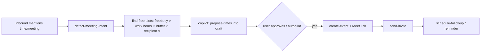

# Ultra-detailed build plan — AI Email Operator in `efforts/tartly`

Status: **implemented (shipped)** · Target: **Vercel Hobby now, Pro later** (no code changes on upgrade)
Scope: **Intelligent inbox · Meeting scheduling · Follow-ups.** (No voice feature.)
Hard rule: **do not disrupt the existing onboarding → AI-chat flow. Add to it.**

> Product: an intelligent inbox that triages your mail, drafts replies, schedules
> meetings, and handles follow-ups, so you spend less time managing email.

---

## 0. Ground rules and the current baseline

**Existing flow we must preserve** (verified in code):

```
/  ──▶ /auth (if signed out) ──▶ /onboarding ──▶ /dashboard ──▶ /ai-chat
                                  │
       PROFILE_CREATION ─▶ SYNC_EMAIL ─▶ COMPLETED
                          (linkSocial google: gmail.readonly + calendar.readonly)
                          callback: /api/onboarding/sync-email/complete
                          advance() → COMPLETED; /onboarding redirects COMPLETED → /dashboard
                          /ai-chat/layout redirects non-COMPLETED → /onboarding
```

Existing pieces we reuse, not replace:
- `lib/onboarding/{types,status,constants,server}.ts`, `components/onboarding/**`
- `apps`/session: `lib/session.ts`, `lib/auth.ts`, `proxy.ts`
- `lib/db/schema.ts` (Drizzle) + `lib/db/migrate.ts`
- `lib/ai/{provider,stream-reply,sse-client,chat-service}.ts`, `app/api/ai/**`, `components/ai-chat/**`
- `@upstash/redis` (`lib/redis.ts`), AI SDK v7 (`ai`), Next 16 (`proxy.ts`, `after()`)

**Non-disruption contract (every change must satisfy):**
1. No existing route path changes.
2. No existing onboarding step is removed or reordered; only scopes widen and one new
   step is *appended* (calendar is optional and skippable).
3. `/ai-chat` keeps working exactly as today; the inbox is a sibling route.
4. Every new feature is additive files + at most a one-line insertion into an existing file.

---

## 1. Hobby strategy (the single most important design decision)

Hobby cron is **once per day**, so **the cron must not be the primary trigger.** The design is
**push-first, event-driven**:

```
Gmail receives mail
  └─▶ users.watch → Google Pub/Sub → POST /api/webhooks/gmail
         ├─ verify OIDC · dedupe on messageId · insert event_log row
         ├─ return 200 in <1s
         └─ after(() => processEvent(...))        ← runs in THIS invocation, ≤300s on Hobby
                └─ triage → (maybe) draft → (maybe) propose meeting → (maybe) enqueue follow-up
```

Three complementary triggers, in priority order:

1. **Push (real-time, primary).** New mail is processed inside the webhook invocation via
   `after()` / `waitUntil`. No cron needed for the happy path.
2. **Opportunistic drain (activity-paced).** Any authenticated app request (inbox open, thread
   open, "Sync now") fires a bounded `after(() => drain(batch))`. Uses an Upstash lock so
   concurrent requests don't stampede. This is how pending work drains during the day without cron.
3. **One daily cron (safety net).** `/api/v1/cron/daily` fans out: watch-renew, missed-history
   backfill, due follow-ups, reaper, reconciliation. One entry → Hobby-safe regardless of the
   cron-count cap.

Upgrade to Pro is a **config-only** change: add two `vercel.json` entries
(`/api/v1/cron/drain` every minute, `/api/v1/cron/followups` every 5 min). No application code
changes, because the drain route already exists and is invoked by `daily` on Hobby.

---

## 2. Onboarding changes (permissions for email + calendar + meetings)

Goal: by the time the user lands in the app, we hold `gmail.modify`, `gmail.send`,
`calendar.readonly`, `calendar.events` and a default timezone/working-hours profile.

### 2.1 Widen the existing connect step (no new UI)

**Modify `lib/onboarding/constants.ts`:**

```ts
export const GOOGLE_CONNECT_SCOPES = [
  "https://www.googleapis.com/auth/gmail.modify",   // was gmail.readonly
  "https://www.googleapis.com/auth/gmail.send",
  "https://www.googleapis.com/auth/calendar.readonly",
  "https://www.googleapis.com/auth/calendar.events", // new: create events
] as const;
```

Nothing else in the step changes: `sync-email-step.tsx` already passes `GOOGLE_CONNECT_SCOPES`
to `authClient.linkSocial`, and `/api/onboarding/sync-email/complete` already verifies every
scope in that constant via `hasGrantedScopes`. Widening the constant propagates automatically.

**Modify copy in `components/onboarding/steps/sync-email-step.tsx`** (2 strings only):
- Subtitle → “Connect email and calendar so your assistant can read, draft, and schedule.”
- Helper line → “You’ll grant read, send, and calendar access. You can change this later.”

### 2.2 Record the calendar connection (additive column)

**Add to `onboardingState` in `lib/db/schema.ts`:**

```ts
connectedCalendarProvider: text("connected_calendar_provider"),
calendarTimezone: text("calendar_timezone"),
```

**Add to the snapshot** in `lib/onboarding/types.ts` (`connectedCalendarProvider`,
`calendarTimezone`) and `toSnapshot`/`OnboardingStatusPatch` in `lib/onboarding/server.ts`.

### 2.3 Calendar settings step (appended, skippable, non-blocking)

The existing flow is `PROFILE_CREATION → SYNC_EMAIL → COMPLETED`. Append one step:

```
PROFILE_CREATION → SYNC_EMAIL → CALENDAR_SETUP → COMPLETED
```

- `lib/onboarding/types.ts`: add `CALENDAR_SETUP`.
- `lib/onboarding/status.ts`: insert `CALENDAR_SETUP` between `SYNC_EMAIL` and `COMPLETED`;
  add to `ONBOARDING_STEP_META` (title “Meetings”, subtitle “When can your assistant book time?”).
  Backward compat: rows already at a live status keep advancing correctly because the order
  array is the only source; `COMPLETED` rows are unaffected. Add a guard: if the user granted no
  calendar scope, `CALENDAR_SETUP` auto-advances.
- `components/onboarding/steps/onboarding-step-router.tsx`: add `case CALENDAR_SETUP:
  return <CalendarSetupStep />;` (one line).
- **New** `components/onboarding/steps/calendar-setup-step.tsx`: reuse `OnboardingStepPage/
  Heading/ContentBlock` and `OnboardingSkipButton` exactly like `SyncEmailStep`; fields =
  timezone (default from `Intl.DateTimeFormat().resolvedOptions().timeZone`), work days,
  work hours, meeting length, buffer. Writes via a new
  `POST /api/onboarding/calendar` then `advance()`.
- Timezone is the only field that is effectively required; everything else has sane defaults
  and can also be edited later under Settings.

### 2.4 Landing destination (optional, one line)

Today `COMPLETED` sends users to `/dashboard` which shows “Open AI chat”. To “land on the
application with the AI chat”, either:
- **keep as-is** (dashboard is a friendly welcome screen that links in), or
- change `app/onboarding/page.tsx` `redirect("/dashboard")` → `redirect("/ai-chat")` and keep
  `/dashboard` reachable. Recommend the latter only if you want chat-first; it is a one-line,
  reversible change and does not break `/dashboard`.

---

## 3. UI integration (additive, non-disruptive)

The app shell today is `app/ai-chat/layout.tsx` rendering `<AiChatSidebar/>`. The inbox is a
**sibling route** with the **same shell**, and we insert **one nav component** into both layouts.

```
app/
  ai-chat/            (unchanged paths: /ai-chat, /ai-chat/[threadId])
  inbox/              NEW
    layout.tsx        session + onboarding guard + <AppShell><InboxNav/></AppShell>
    page.tsx          needs-you / waiting / handled lists
    [threadId]/page.tsx  thread view: messages + draft card + meeting card
```

**New `components/app-shell/app-shell.tsx`** — the visual frame (sidebar column + main column),
extracted from the exact classes already used in `app/ai-chat/layout.tsx`. Reusing the classes
keeps the two screens visually identical.

**New `components/app-shell/app-nav.tsx`** — small vertical switch at the top of the sidebar:
`Chat` (→ `/ai-chat`) and `Inbox` (→ `/inbox`), highlighting the active route.

**One-line insertion** into `components/ai-chat/ai-chat-sidebar.tsx` header:

```tsx
<div className="flex h-12 ...">
  <AppNav />                       {/* ← added; the page's own "AI chat" title stays below or beside */}
  ...
</div>
```

For `/inbox`, build `components/inbox/{inbox-list,inbox-row,inbox-filters,draft-card,meeting-card}`
using the existing `components/ui/*` primitives (card, badge, button, tabs, scroll-area) and the
existing visual tokens (`bg-canvas`, `border-border`, `text-muted-foreground`). No new design
system.

**Optionally later** (not now): move `ai-chat` and `inbox` under a route group `app/(app)/` so the
shell is defined once. URLs do not change in a route group, so this remains non-breaking — but it
touches existing files, so it is deferred until the inbox ships.

---

## 4. Data model (Drizzle, `lib/db/schema.ts`)

Better Auth’s `account` table already stores `access_token`/`refresh_token`/`scope`; tokens are
read via `auth.api.getAccessToken({ body: { providerId: "google", userId } })`. **No token store.**

```ts
// --- Connections -----------------------------------------------------------
mailboxes(id text pk, userId→user, email, provider default 'google',
          historyId text, watchExpiration timestamp, autonomy text default 'copilot',
          lastSyncedAt timestamp, createdAt, updatedAt)
calendarSettings(userId pk→user, timezone text, workDays jsonb default '[1,2,3,4,5]',
                 workStartHour int default 9, workEndHour int default 18,
                 bufferMins int default 15, defaultDurationMins int default 30)

// --- Mirrors (Gmail canonical for actions; mirror for agent + UI + evals) ---
threads(id pk, mailboxId→mailboxes, gmailThreadId text unique, subject,
        lastMessageAt timestamp, labels jsonb, isUnread bool, createdAt, updatedAt)
threadStates(threadId pk→threads, category text, priority int, action text, updatedAt)
messages(id pk, threadId→threads, gmailMessageId text unique, direction text,
         fromAddr text, toAddr jsonb, subject, bodyText, bodyHtml, snippet,
         sentAt timestamp, createdAt)
contacts(id pk, userId→user, email text, name, nameLower, source,
         lastContactedAt timestamp, autonomyOverride text, createdAt, updatedAt)

// --- Meetings --------------------------------------------------------------
meetings(id pk, userId→user, threadId→threads, calendarEventId text unique,
         proposalId text, subject, startAt timestamp, endAt timestamp,
         meetLink text, status text, createdAt)

// --- Follow-ups ------------------------------------------------------------
followupSequences(id pk, userId→user, name, graph jsonb, isActive bool, createdAt)
followupEnrollments(id pk, userId→user, threadId→threads, sequenceId→followupSequences,
                    stage text, attempts int default 0, nextEvalAt timestamp,
                    status text default 'active', lastError text, createdAt, updatedAt)

// --- Engine ----------------------------------------------------------------
flows(id pk, userId→user, name, graph jsonb, isActive bool, createdAt)
flowRuns(id pk, userId→user, flowId→flows, triggerKind text, status text,
         state jsonb, error jsonb, trace jsonb, startedAt, finishedAt)
flowCheckpoints(id pk, runId→flowRuns, nodeId text, status text, output jsonb, createdAt)

// --- Copilot drafts --------------------------------------------------------
drafts(id pk, userId→user, threadId→threads, runId→flowRuns, body text, editedBody text,
       status text default 'pending', decidedAt timestamp, createdAt)

// --- Durable work ----------------------------------------------------------
jobQueue(id pk, userId→user, laneKey text, kind text, payload jsonb,
         status text default 'pending', priority int default 100,
         runAfter timestamp default now, attempts int default 0, maxAttempts int default 5,
         lastError text, lockedBy text, lockedAt timestamp,
         sourceEventId text, createdAt,
         unique(userId, sourceEventId))
eventLog(id pk, userId→user, kind text, externalId text, payload jsonb,
         processedAt timestamp, createdAt, unique(userId, externalId))
sendLedger(id pk, userId→user, jobId→jobQueue, idempotencyKey text unique,
           status text, seq int, createdAt)
```

Indexes: `threads(userId,lastMessageAt desc)`, `messages(threadId,sentAt)`,
`jobQueue(status,runAfter)` partial `where status='pending'`,
`followupEnrollments(status,nextEvalAt)`, `contacts(userId,email)`,
`eventLog(userId,externalId)` unique.

Migrations via existing `pnpm db:generate` + `pnpm db:migrate` (`lib/db/migrate.ts`).

---

## 5. Engine — Step / Flow / Run (`lib/engine/**`)

### 5.1 `lib/engine/step.ts`

```ts
import type { ZodType } from "zod";
export interface StepCtx {
  db: Db; userId: string; runId: string;
  state: Record<string, unknown>;
  log: (event: string, data?: unknown) => void;
}
export interface StepDefinition<I, O> {
  type: string;
  configSchema: ZodType<I>;
  policy?: "critical" | "best_effort";   // default "critical"
  run(ctx: StepCtx & { input: I }): Promise<O>;
}
```

### 5.2 `lib/engine/registry.ts`

```ts
const STEPS = new Map<string, StepDefinition<any, any>>();
export const registerStep = (s: StepDefinition<any, any>) => STEPS.set(s.type, s);
export const getStep = (t: string) => STEPS.get(t);
let loaded = false;
export function loadSteps() {
  if (loaded) return; loaded = true;
  require("./steps/triage"); require("./steps/classify-intent");
  require("./steps/load-context"); require("./steps/draft-reply");
  require("./steps/guardrails"); require("./steps/egress");
  require("./steps/send-email"); require("./steps/detect-meeting-intent");
  require("./steps/find-free-slots"); require("./steps/propose-times");
  require("./steps/create-event"); require("./steps/send-invite");
  require("./steps/schedule-followup"); require("./steps/handoff");
  require("./steps/log-trace");
}
```

### 5.3 `lib/engine/run.ts`

```ts
export async function runFlow(db, runId, flow, trigger) {
  loadSteps();
  let node = firstNode(flow.graph);
  let state: Record<string, unknown> = { trigger };
  while (node) {
    const step = getStep(node.type);
    if (!step) return failRun(db, runId, node.id, new Error(`unknown step ${node.type}`));
    const input = step.configSchema.parse(node.config);
    try {
      const out = await step.run({ db, userId, runId, state, log, input });
      await checkpoint(db, runId, node.id, out, "ok");
      state = { ...state, ...out };
    } catch (err) {
      if ((step.policy ?? "critical") === "best_effort")
        await checkpoint(db, runId, node.id, err, "error");
      else return failRun(db, runId, node.id, err);
    }
    node = next(flow.graph, node, state);
  }
  return completeRun(db, runId);
}
```

`trace` accumulates `{ nodeId, type, status, ms, output }` per node → the run panel and evals.

### 5.4 Default flows (seeded as `flows.graph`)

```jsonc
// inbound-email
{ "nodes": [
  { "id": "t",  "type": "triage" },
  { "id": "c",  "type": "classify-intent" },
  { "id": "l",  "type": "load-context" },
  { "id": "m",  "type": "detect-meeting-intent" },
  { "id": "s",  "type": "find-free-slots" },
  { "id": "p",  "type": "propose-times" },
  { "id": "d",  "type": "draft-reply" },
  { "id": "g",  "type": "guardrails" },
  { "id": "e",  "type": "egress" },
  { "id": "x",  "type": "send-email" },
  { "id": "f",  "type": "schedule-followup" },
  { "id": "r",  "type": "log-trace" }
], "edges": [ /* linear + conditionals, see §7 */ ] }
```

---

## 6. Step catalogue (input → output, policy)

| Step | Input (Zod) | Output | Policy |
|---|---|---|---|
| `triage` | `{maxBodyChars?}` | `{category, priority, action}` | critical |
| `classify-intent` | `{model?}` | `{intent, sentiment, confidence, wantsMeeting}` | critical |
| `load-context` | `{historyLimit?}` | `{history, contact, thread}` | critical |
| `draft-reply` | `{maxParagraphs?, tone?}` | `{body}` | critical |
| `guardrails` | `{enabled:string[]}` | `{violations:string[], forcedDraft:bool}` | critical |
| `egress` | `{}` | `{decision:"draft"\|"send", reason}` | critical |
| `send-email` | `{idempotencyKey}` | `{gmailMessageId}` | critical |
| `detect-meeting-intent` | `{keywords?}` | `{isMeeting:bool, durationMins?}` | critical |
| `find-free-slots` | `{count, horizonDays}` | `{slots:[{startUtc,endUtc,label}]}` | best_effort |
| `propose-times` | `{maxOptions}` | `{options:[string]}` | critical |
| `create-event` | `{slotIndex}` | `{eventId, meetLink, startAt, endAt}` | critical |
| `send-invite` | `{}` | `{sent:bool}` | critical |
| `schedule-followup` | `{afterDays, sequenceId?}` | `{enrollmentId}` | best_effort |
| `handoff` | `{reason}` | `{notified:bool}` | critical |
| `log-trace` | `{}` | `{}` | best_effort |

`egress` is the **single send gate**: reads `mailboxes.autonomy` and
`contacts.autonomyOverride`; returns `draft` unless autopilot **and** `guardrails.forcedDraft`
is false. Nothing else may call `gmail.send`.

---

## 7. Feature flows in detail

### 7.1 Intelligent inbox
- `triage` (AI SDK `generateObject`, cheap model) → `category ∈ {needs_reply, awaiting_reply,
  fyi, meeting_request, invoice, newsletter, spam}`, `priority`, `action ∈ {draft, none, handoff}`.
- Writes `threadStates`; the inbox renders from Postgres instantly, no model call on page load.
- Views: **Needs you** (`needs_reply|meeting_request`, priority desc), **Waiting on them**
  (`awaiting_reply` or active follow-up enrollment), **Handled/FYI**.
- UI: `/inbox` lists grouped; row shows sender, subject, category chip, 1-line snippet, due hint.

### 7.2 Meeting scheduling

- `find-free-slots` calls Calendar `freebusy.query` for the user’s calendars, subtracts buffers,
  intersects working hours from `calendarSettings`, and renders each slot in the **recipient’s**
  timezone (inferred from thread/domain, fallback UTC).
- Invariant: store instants in UTC; never let the model compute a date. Relative phrases are
  resolved against `now()` in the relevant zone before they reach the prompt.
- Idempotency: one event per `(threadId, proposalId)`; a re-run updates the existing event.
- Fallback: a booking link (`NEXT_PUBLIC_BOOKING_URL`, e.g. Cal.com) when no slot is agreed in 2
  exchanges.

### 7.3 Follow-ups
- Enroll on `awaiting_reply` (inbound nudge) or from a `followupSequences.graph` (outbound cadence:
  `send → wait → condition → send → end`).
- Clock: `schedule-followup` inserts a `jobQueue` row with `runAfter = now()+interval` and a
  `followupEnrollments` pointer. The daily cron (Hobby) or `followups` cron (Pro) enqueues due
  enrollments.
- **Stop rules (mandatory):** any inbound reply pauses/cancels the enrollment; a manual send by
  the user pauses it; caps on attempts/spacing/frequency; quiet hours + weekends + holidays in the
  recipient’s timezone; never follow up `is_unreachable` addresses; detect opt-out language and
  stop permanently.
- Reactivity is a small function `reactivity.onInbound(threadId)` called from the inbound flow.

---

## 8. Gmail I/O (`lib/gmail/**`)

```
lib/gmail/client.ts   accessToken via auth.api.getAccessToken; gmailFetch with 401/403→reconnect
lib/gmail/parse.ts    MIME walk, base64url, text+html, address parsing, RFC2047
lib/gmail/mime.ts     buildMime (RFC2822, RFC2047 headers, base64url)
lib/gmail/sync.ts     users.history.list(startHistoryId) → upsert threads/messages; store historyId
lib/gmail/watch.ts    users.watch({topicName, labelIds:["INBOX"]}) → store watchExpiration
lib/gmail/send.ts     messages.send with sendLedger idempotency
```

- **Outbound** goes only through `send-email` → `lib/gmail/send.ts`, guarded by `sendLedger`
  (unique `idempotencyKey`) so a retried drain never double-sends.
- **Watch expiry** (~7 days) is renewed by the daily cron; the row carries `watchExpiration`.
- **Webhook** `app/api/webhooks/gmail/route.ts`: verify the Pub/Sub OIDC token against Google
  JWKS with the configured audience; base64-decode `message.data` → `{emailAddress, historyId}`;
  dedupe; insert `eventLog`; `after()` the process; return 200.
- Scopes are Google *restricted* → verification + CASA before public launch; keep the OAuth app in
  testing with explicit test users until then. The plan does not depend on approval to be built.

---

## 9. Durable queue (`lib/queue/**`)

Ported from Deskcomm’s `job_queue` primitives, Postgres-only:

```
enqueue(db, userId, {kind, laneKey, payload, runAfter, sourceEventId, maxAttempts})
claim(db, {workerId, maxConcurrency, batchSize})   -- FOR UPDATE SKIP LOCKED, one running per lane
complete(db, jobId, workerId)
fail(db, jobId, workerId, error)                   -- backoff min(2^(a-1)*10s,120s) → dead
reap(db, {visibilityTimeoutMs})                    -- revive dead workers
```

On Neon (serverless) use the pooled connection (`DATABASE_URL` pooler). `laneKey` prevents two
jobs for the same thread running concurrently. Crons **may double-fire**; `claim` + `sendLedger`
make processing idempotent.

---

## 10. Routes and cron

### Cookie-auth (`requireSession`, `userId` from session — never the body)
```
GET    /api/v1/inbox                        list by view (?view=needs_you|waiting|handled&since=)
GET    /api/v1/inbox/[threadId]             thread + messages + open draft/meeting
POST   /api/v1/inbox/[threadId]/draft       regenerate a draft
POST   /api/v1/drafts/[id]/approve          send (optional edited body)
POST   /api/v1/drafts/[id]/discard
POST   /api/v1/inbox/sync                   manual sync (also kicks opportunistic drain)
GET/PATCH /api/v1/settings/calendar         working hours, timezone, duration, buffer
GET/PATCH /api/v1/settings/autonomy         mailbox default + per-contact overrides
GET    /api/v1/runs/[id]                    flow trace
GET    /api/v1/followups                    enrollments + pause/stop actions
```

### Non-cookie (own guard, fail-closed)
```
POST /api/webhooks/gmail        Pub/Sub push; OIDC verify; eventLog; after(process); 200
GET  /api/v1/cron/daily         Bearer CRON_SECRET — Hobby entry: renew-watch, backfill,
                                due-followups, reaper, reconcile  (fans out internally)
GET  /api/v1/cron/drain         Bearer — claim+run a bounded batch (Pro: every minute)
GET  /api/v1/cron/followups     Bearer — due enrollments (Pro: every 5 min)
```

`vercel.json`:
```jsonc
// Hobby (now)
{ "crons": [{ "path": "/api/v1/cron/daily", "schedule": "0 3 * * *" }] }
// Pro (later) — config only, no code change
{ "crons": [
  { "path": "/api/v1/cron/drain",     "schedule": "* * * * *" },
  { "path": "/api/v1/cron/followups", "schedule": "*/5 * * * *" },
  { "path": "/api/v1/cron/daily",     "schedule": "0 3 * * *" }
] }
```
Vercel sends `Authorization: Bearer $CRON_SECRET` automatically when `CRON_SECRET` is set.

Every route uses `withUser(request)` → `{ userId }` from `getSession()`, Zod-validates input, and
returns `{ data }` or `{ error: { code, message } }`. `userId` never comes from the body.

---

## 11. Environment variables (add to `.env.example` and validate in `lib/env.ts`)

```
# existing: DATABASE_URL BETTER_AUTH_* GOOGLE_CLIENT_ID GOOGLE_CLIENT_SECRET
#           UPSTASH_REDIS_REST_URL UPSTASH_REDIS_REST_TOKEN OPENCODE_API_KEY AI_BASE_URL AI_MODEL_ID
CRON_SECRET=                       # Vercel cron auth (required once crons are added)
GOOGLE_PUBSUB_TOPIC=projects/…/topics/gmail-inbox
GOOGLE_PUBSUB_AUDIENCE=            # push endpoint URL used as the OIDC audience
GOOGLE_PUBSUB_PUSH_SERVICE_ACCOUNT_EMAIL=  # exact --push-auth-service-account identity
NEXT_PUBLIC_BOOKING_URL=           # optional booking fallback
AI_MODEL_CLASSIFIER_ID=            # cheap model for triage/classification
AI_MODEL_DRAFT_ID=                 # drafting model
```

`lib/env.ts` gets these as `optional()` except `CRON_SECRET`/`GOOGLE_PUBSUB_TOPIC`, which are
required only when the feature is enabled.

---

## 12. Phased task checklist (granular, ship in order)

> **Implementation note (2026-10-03).** All phases below are **shipped** and green;
> the boxes were ticked retroactively (they were never updated as the work
> landed). Evidence: the module/route inventory in [`README.md`](./README.md),
> the Phase A–D tracker in
> [`PLAN-production-hardening.md`](./PLAN-production-hardening.md), and the unit
> (184 tests) + integration (86 tests) suites. Commands: `npx tsc --noEmit`,
> `npm run lint`, `npm run test:unit`, `npm run test:integration`.

### Phase 1 — Onboarding permissions + Gmail I/O
- [x] Widen `GOOGLE_CONNECT_SCOPES` in `lib/onboarding/constants.ts`.
- [x] Update the two copy strings in `sync-email-step.tsx`.
- [x] Add `connectedCalendarProvider`, `calendarTimezone` to `onboardingState` + snapshot/patch.
- [x] Add `CALENDAR_SETUP` to types/status/meta + router case; new `calendar-setup-step.tsx`;
      `POST /api/onboarding/calendar`; auto-skip when calendar scope absent.
- [x] `lib/gmail/{client,parse,mime,sync,send,watch}.ts` (tokens via Better Auth `account`).
- [x] Migrations for `mailboxes`, `threads`, `messages`, `contacts`, `threadStates`,
      `calendarSettings`.
- [x] `POST /api/webhooks/gmail` + `after()` processing stub; `GET /api/v1/cron/daily`
      (watch-renew + history backfill).
- [x] `sendLedger` + idempotent `gmail.send`.
- [x] Tests: scope verification, MIME parse fixtures, history sync dedupe, send idempotency.

### Phase 2 — Engine + queue
- [x] `lib/engine/{step,registry,run,flow}.ts` + `loadSteps()`.
- [x] `lib/queue/{enqueue,claim,complete,fail,reap}.ts`.
- [x] `jobQueue`/`eventLog`/`flows`/`flowRuns`/`flowCheckpoints` migrations.
- [x] `GET /api/v1/cron/drain`; opportunistic `kickDrain()` (Upstash lock) wired into inbox open.
- [x] Seed the default `inbound-email` flow.
- [x] Tests: claim concurrency (SKIP LOCKED), double-fire idempotency, best-effort vs critical.

### Phase 3 — Intelligent inbox
- [x] Steps `triage`, `classify-intent`, `load-context`, `draft-reply`, `guardrails`, `egress`,
      `send-email`, `log-trace`.
- [x] `/api/v1/inbox*` routes; `drafts` approve/discard.
- [x] `app/inbox/**` UI + `AppShell`/`AppNav` + one-line insertion into `ai-chat-sidebar.tsx`.
- [x] Cursor polling (`?since=`) + optimistic updates.
- [x] Tests: triage schema, egress gate (copilot default; guardrail forces draft).

### Phase 4 — Meetings
- [x] `lib/calendar/{client,freebusy,events,meet,tz}.ts`.
- [x] Steps `detect-meeting-intent`, `find-free-slots`, `propose-times`, `create-event`,
      `send-invite`.
- [x] `/settings/calendar` API + UI (can reuse the onboarding component).
- [x] `meetings` migration; idempotency on `(threadId, proposalId)`.
- [x] Tests: tz/DST slot math, buffer/no-overlap, one-event-per-proposal.

### Phase 5 — Follow-ups
- [x] `followupSequences`/`followupEnrollments` migrations; step `schedule-followup`.
- [x] `reactivity.onInbound` wired into the inbound flow (reply pauses enrollment).
- [x] `GET /api/v1/cron/followups` + daily-cron fan-out.
- [x] `/api/v1/followups` pause/stop; minimal UI list.
- [x] Tests: stop-on-reply, caps, quiet hours, unreachable-address exclusion.

### Phase 6 — Guardrails & observability
- [x] Forbidden phrases, numeric/commitment grounding, prompt-injection classifier.
- [x] Per-org AI budget (Upstash counter); `log_trace` → run panel.
- [x] Metrics: runs/day, drafts, approvals, meetings booked, follow-ups sent.

---

## 13. Testing strategy
- Unit (Vitest): MIME parsing, tz/slot math, triage schema, egress decisions, queue claim.
- Integration: webhook → eventLog → drain → draft (mocked Gmail + model).
- Invariants: idempotency (double-fire safe), no cross-user data access, `sendLedger` uniqueness.
- Manual e2e on Hobby: connect a test Google account, send yourself mail, confirm triage + draft.

## 14. Risks, Hobby limits, upgrade path
- **Hobby cron is daily** → the whole design is push-first; the daily cron is a net. If push is
  misconfigured, the inbox lags up to a day. Mitigate with the opportunistic drain and a
  “Sync now” button.
- **Hobby function cap 300s** → the drain processes a bounded batch (default 5 jobs); the reaper
  handles anything a killed invocation leaves running.
- **Crons may double-fire and never retry** → idempotency is mandatory (claim + ledger).
- **Gmail restricted scopes / Calendar sensitive scopes** → Google verification + CASA gate public
  launch; not a build blocker.
- **Upgrade to Pro** = edit `vercel.json` only; add the two crons. No code change.
