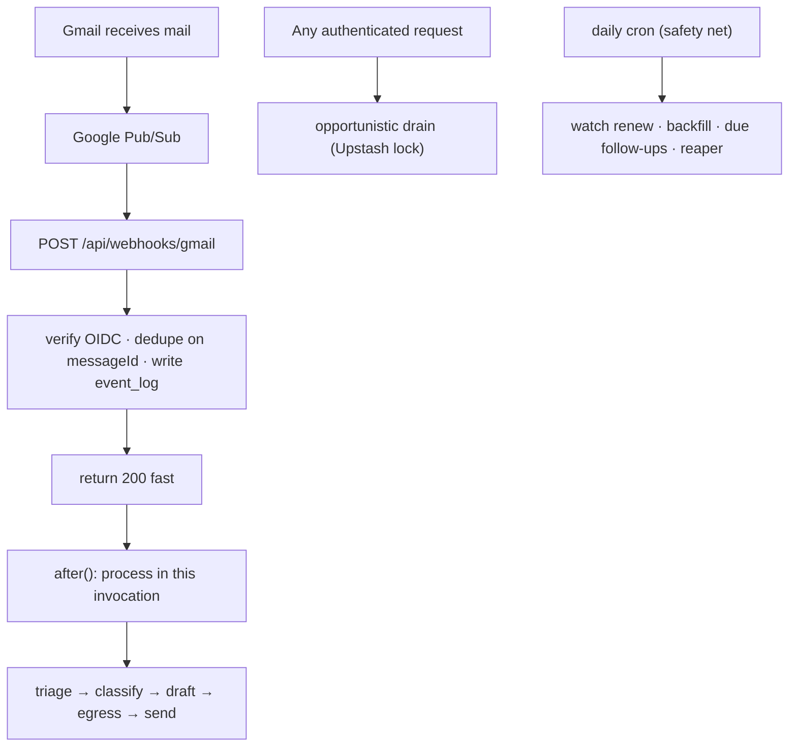

# Tartly — AI Email Client

**Tartly is a web email client with an AI operator built in.** It connects to
your Gmail and Google Calendar and works inside your inbox: it triages incoming
mail, drafts replies in your voice, proposes and books meeting times, and chases
the threads that have gone quiet. Nothing leaves your mailbox without your
review — Tartly drafts and proposes, you approve and send.

> **A full email client, not just an assistant.** `/mail` is a complete
> Gmail-style client (folders, labels, search, compose, read/star/archive/trash)
> that reads live from Gmail. An AI layer rides on top: `/inbox` is the triage
> view, and the `/assistant` chat can operate your mailbox through tools.

This repository is the Next.js application server for Tartly (mirrored here as
`Tartly-Scratch`).

---

## Table of contents

- [What it does](#what-it-does)
- [Screens](#screens)
- [Architecture](#architecture)
- [Tech stack](#tech-stack)
- [Data model](#data-model)
- [Getting started](#getting-started)
- [Environment variables](#environment-variables)
- [Scripts](#scripts)
- [Testing](#testing)
- [Project structure](#project-structure)
- [HTTP API](#http-api)
- [Deployment](#deployment)
- [Collaborating](#collaborating)
- [Security & privacy](#security--privacy)
- [License](#license)

---

## What it does

| Capability | Route | Summary |
| --- | --- | --- |
| **Live mail client** | `/mail` | Full Gmail-style UI: folders, labels, search, compose, and per-message read / star / archive / trash / spam / label actions. Reads live from Gmail and, when both are connected, merges Gmail and Outlook into one **shared inbox** (All Mail). |
| **Connected accounts** | `/settings/accounts` | Connect or reconnect Gmail and Outlook from one place; the shared inbox picks up every connected account. |
| **AI triage inbox** | `/inbox` | Server-rendered views — **Needs you**, **Waiting on them**, **Handled** — driven by an AI triage step rather than a live model call on page load. |
| **Drafts & approval** | `/inbox/[threadId]` | Tartly writes a reply in your voice; you edit, approve (send) or discard it. A single send gate guarantees nothing goes out unreviewed. |
| **Meeting scheduling** | `/calendar` | Detects meeting intent, finds free slots against your working hours and Calendar, proposes times, then books the event with a Google Meet link. |
| **Follow-ups** | `/followups` | Tracks threads waiting on a reply and nudges — or drafts the nudge — with stop rules (reply detection, caps, quiet hours, opt-out detection). |
| **Agent chat** | `/assistant` | A tool-using agent that can search/read mail, draft, send (with confirmation), schedule, and research. |
| **24/7 Autopilot** | `/settings/autopilot` | Opt-in: let a mailbox send *safe* replies on its own inside a window you choose. Risk checks, caps and loop protection; anything risky becomes a draft. |
| **Activity & traces** | `/activity`, `/runs` | Counts of runs, drafts, sends, meetings, follow-ups, plus a per-run step trace for debugging. |
| **Settings** | `/settings/calendar` | Working hours, timezone, meeting duration and buffer, plus autonomy (copilot vs. autopilot). |

Onboarding walks a new user through **Google sign-in → create profile → connect
inbox + calendar → meeting preferences**, then lands them in the app.

---

## Screens

| Route | Description |
| --- | --- |
| `/` | Marketing landing page (what Tartly is, permissions, data promises). |
| `/auth` | Google sign-in. A valid session redirects to `/mail`. |
| `/onboarding` | Multi-step onboarding; completed users redirect into the app. |
| `/mail` · `/mail/[id]` | Live Gmail client and message reader. |
| `/inbox` · `/inbox/[threadId]` | AI triage inbox and thread view (messages + draft/meeting cards). |
| `/calendar` | Booked meetings agenda (upcoming / past). |
| `/followups` | Active and stopped follow-up enrollments. |
| `/assistant` | Tool-using agent chat. |
| `/activity` | Operator activity dashboard (charts, budget, activity log). |
| `/runs` · `/runs/[id]` | Flow-run index and step trace. |
| `/settings/calendar` | Calendar, working-hours and autonomy settings. |
| `/settings/accounts` | Connected accounts: connect or reconnect Gmail and Outlook; the shared All Mail view merges them. |
| `/settings/autopilot` | 24/7 Autopilot: master switch, send window, risk limits, preview and pause. |
| `/privacy`, `/terms` | Legal pages. |
| `/dev-profile` | Local development profile harness (excluded from the proxy guard). |

---

## Architecture

Tartly is intentionally **push-first and event-driven**, because the Vercel
Hobby plan only allows a once-daily cron. The cron is a safety net, not the
trigger.



Three complementary triggers, in priority order:

1. **Push (real-time, primary).** New mail is processed inside the webhook
   invocation via `after()`. No cron needed for the happy path.
2. **Opportunistic drain.** Any authenticated request (open inbox, open thread,
   "Sync now") fires a bounded `after(() => drain(batch))`, guarded by an
   Upstash lock so concurrent requests don't stampede.
3. **One daily cron.** `/api/v1/cron/daily` fans out: watch-renew,
   missed-history backfill, due follow-ups, reaper, reconciliation.

Upgrading to Vercel Pro is a **config-only** change (add the `drain` and
`followups` crons to `vercel.json`); the routes already exist.

### The flow engine

Mail automation is modelled as **steps → flows → runs**:

- **Step** (`lib/engine/step.ts`) — a typed unit of work with a Zod config
  schema, a `run()` function, and a policy (`critical` or `best_effort`).
- **Flow** (`lib/engine/flow.ts`) — a JSON graph of steps and edges, seeded per
  user (e.g. `inbound-email`).
- **Run** (`lib/engine/run.ts`) — one execution; every node is checkpointed to
  `flow_checkpoints` and traced into `flow_runs.trace`.

Steps include `triage`, `classify-intent`, `load-context`, `draft-reply`,
`guardrails`, `egress`, `send-email`, `detect-meeting-intent`, `find-free-slots`,
`propose-times`, `create-event`, `send-invite`, `schedule-followup`, `handoff`,
and `log-trace`. The `egress` step is the **single send gate**: it reads the
mailbox autonomy and per-contact override, and only allows an automatic send in
`autopilot` mode when guardrails pass.

### Durable work

- **Postgres queue** (`lib/queue/queue.ts`) — `enqueue` / `claim`
  (`FOR UPDATE SKIP LOCKED`) / `complete` / `fail` with backoff / `reap`. A
  `laneKey` serializes work per thread; a partial unique index allows only one
  running job per lane.
- **Idempotency** — `event_log` dedupes provider events; `send_ledger` has a
  unique `idempotency_key` so a retried drain or double-fired cron can never
  send twice.
- **Guardrails** (`lib/guardrails/`) — forbidden phrases, grounding checks and
  prompt-injection detection.

### Integrations

- **Gmail** (`lib/gmail/`) — token access via Better Auth's `account` table;
  MIME parse/build, `history.list` incremental sync, `users.watch`, idempotent
  send.
- **Google Calendar** (`lib/calendar/`) — free/busy, events, Meet links,
  timezone-aware slot math.
- **Better Auth** (`lib/auth.ts`) — Google OAuth only; sessions in Postgres
  (source of truth) with Upstash Redis as a speed layer and JWE cookie cache.
- **Agent runtime** (`lib/agent/`) — tool registry, risk/permission model, and a
  server-verified confirmation flow (`pending_actions`) for external side
  effects.
- **ImageKit** (`lib/imagekit/`, `components/media/`) — CDN image/video delivery
  with on-the-fly transformations. `MediaImage` / `MediaVideo` wrap the
  `@imagekit/next` SDK and fall back to plain elements while
  `NEXT_PUBLIC_IMAGEKIT_URL_ENDPOINT` is unset. CSP allows the endpoint.

---

## Tech stack

| Layer | Choice |
| --- | --- |
| Framework | Next.js 16 (App Router, Proxy guard) · React 19 · TypeScript |
| Styling | Tailwind CSS v4 · Base UI / shadcn-style primitives · Motion |
| Auth | Better Auth (Google OAuth) · Upstash Redis secondary storage |
| Database | PostgreSQL · Drizzle ORM / Drizzle Kit |
| AI | Vercel AI SDK v7 · OpenAI-compatible OpenCode endpoint |
| Agent UI | `@assistant-ui/react` · `streamdown` · AI Elements |
| Docs/rendering | Shiki, react-jsx-parser, `@xyflow/react` |
| Hosting | Vercel (crons) · serverless Postgres · Upstash Redis |

---

## Data model

Defined in `lib/db/schema.ts`; migrations live in `drizzle/`.

**Auth** — `user`, `session`, `account`, `verification`.

**Onboarding** — `onboarding_state` (single-tenant state machine).

**Agent chat** — `agent_chat_thread`, `agent_chat_message`, `agent_runs`,
`pending_actions`, `scheduled_actions`, `research_cache`.

**Email operator** — `mailboxes`, `threads`, `messages`, `contacts`,
`thread_states`, `calendar_settings`.

**Work primitives** — `event_log`, `send_ledger`, `job_queue`, `flows`,
`flow_runs`, `flow_checkpoints`.

**Meetings & follow-ups** — `meetings`, `followup_sequences`,
`followup_enrollments`, `drafts`.

**24/7 Autopilot** — `autopilot_policies` (per-mailbox send policy) and
`autopilot_decisions` (content-free audit: reason, category, confidence and
boolean checks only).

Apply migrations with:

```bash
npm run db:migrate
```

---

## Getting started

### Prerequisites

- **Node.js 20+** and npm
- **PostgreSQL** (local, Neon, Supabase, …)
- **Upstash Redis** REST credentials
- A **Google Cloud OAuth 2.0** client

### 1. Install

```bash
git clone git@github.com:Tartly/Tartly-Scratch.git
cd Tartly-Scratch
npm install
```

### 2. Configure the environment

```bash
cp .env.example .env.local
```

Fill in the **required** block (database, auth secret, Google OAuth, Upstash).
Everything else is optional — see [Environment variables](#environment-variables).

In Google Cloud Console, add this authorized redirect URI to your OAuth client:

```
${BETTER_AUTH_URL}/api/auth/callback/google
```

### 3. Create the database schema

```bash
npm run db:generate   # only after editing the schema
npm run db:migrate    # apply migrations
# or, for rapid prototyping:
npm run db:push
```

### 4. Run

```bash
npm run dev
```

Open <http://localhost:3000>, sign in with Google, and complete onboarding. The
assistant degrades gracefully to an offline demo when no AI key is configured.

---

## Environment variables

The full, documented template is **[`.env.example`](./.env.example)**. Only these
are **required** to boot:

| Variable | Purpose |
| --- | --- |
| `DATABASE_URL` | Postgres connection string (use the pooled endpoint on serverless). |
| `BETTER_AUTH_SECRET` | Signs sessions/tokens — `openssl rand -base64 32`. |
| `BETTER_AUTH_URL` | Canonical origin; OAuth/cookies are pinned to it. |
| `NEXT_PUBLIC_BETTER_AUTH_URL` | Same origin, exposed to the browser. |
| `GOOGLE_CLIENT_ID` / `GOOGLE_CLIENT_SECRET` | Google OAuth credentials. |
| `UPSTASH_REDIS_REST_URL` / `UPSTASH_REDIS_REST_TOKEN` | Redis speed layer. |

Everything else is **optional and feature-gated**; blank means "off", not
"broken". You do **not** need AI keys, Pub/Sub, cron, or research keys to run
the mail client locally. On Vercel, add values in
**Project → Settings → Environment Variables** — never commit a `.env`.
`NEXT_PUBLIC_*` values are inlined at build time.

---

## Scripts

| Command | Description |
| --- | --- |
| `npm run dev` | Start the dev server. |
| `npm run build` | Production build. |
| `npm start` | Serve the production build. |
| `npm run lint` | ESLint. |
| `npm run db:generate` | Generate a migration from schema changes. |
| `npm run db:migrate` | Apply migrations. |
| `npm run db:push` | Push schema directly (prototyping). |
| `npm run db:studio` | Open Drizzle Studio. |
| `npm test` | Run the full smoke/eval suite (see below). |

### Testing

The suite is a set of `tsx` harnesses under `scripts/`, run without a live
Google account by shimming `server-only` (`scripts/onboarding-test-shims`).

```bash
npm run test:onboarding
npm run test:ai-chat
npm run test:email-operator        # phases 1–8 + autopilot
npm run test:autopilot             # 24/7 Autopilot gate + audit only
npm run test:agent                 # phase 1
npm run test:agent:phase2 … phase7
npm run test:agent:evals
```

`npm test` chains all of the above.

---

## Project structure

```
app/
  (pages)              landing, auth, onboarding, mail, inbox, calendar,
                       followups, activity, runs, settings, assistant, legal
  api/
    auth/              Better Auth handler
    onboarding/        profile, calendar, sync-email completion
    ai/                chat threads + streaming assistant
    v1/                mail, inbox, drafts, meetings, followups, metrics,
                       runs, settings, agent, cron
    webhooks/gmail/    Pub/Sub push endpoint
components/
  app-shell/           sidebar, shell, command palette
  mail/                live Gmail client (list, reader, compose, store)
  inbox/               triage list, thread view, draft/meeting cards
  assistant/           agent chat, approvals, tool steps
  ai-elements/         chat/agent UI primitives
  onboarding/          steps, animations, welcome overlay
  calendar/ followups/ settings/ marketing/ ui/
lib/
  agent/               tool registry, loop, permissions, persistence
  ai/                  provider, streaming, chat service, fallbacks
  calendar/ gmail/     Google integrations
  engine/              step / flow / run engine + steps
  queue/               Postgres job queue
  email-operator/      handlers, drain, cron, jobs
  followup/ guardrails/ inbox/ mail/ metrics/ services/
  db/                  Drizzle schema, client, migrations runner
  onboarding/ auth.ts env.ts redis.ts session.ts
drizzle/               generated SQL migrations + metadata
scripts/               smoke tests, agent phases, evals
docs/plans/            architecture and build plans
```

---

## HTTP API

All `/api/v1/*` routes authenticate from the session cookie (`lib/session.ts`)
and return `{ data }` or `{ error: { code, message } }`.

| Group | Routes |
| --- | --- |
| **Mail (live Gmail)** | `GET /api/v1/mail/profile` · `GET /api/v1/mail/messages` · `GET /api/v1/mail/messages/[id]` · `POST …/read · star · archive · trash · spam · label` · `GET/POST /api/v1/mail/drafts` · `POST /api/v1/mail/send` · `GET /api/v1/mail/labels` · `GET /api/v1/mail/events` |
| **Inbox (triage)** | `GET /api/v1/inbox` · `GET /api/v1/inbox/[threadId]` · `POST …/draft` · `POST /api/v1/inbox/sync` |
| **Drafts** | `POST /api/v1/drafts/[id]/approve` · `POST /api/v1/drafts/[id]/discard` |
| **Meetings** | `GET/POST /api/v1/meetings` · `POST /api/v1/meetings/book` · `GET/PATCH/DELETE /api/v1/meetings/[id]` |
| **Follow-ups** | `GET /api/v1/followups` · `POST …/[id]/pause` · `POST …/[id]/stop` |
| **Settings** | `GET/PATCH /api/v1/settings/calendar` · `GET/PATCH /api/v1/settings/autonomy` · `GET/PATCH /api/v1/settings/autopilot` · `POST /api/v1/settings/autopilot/pause` · `POST /api/v1/settings/autopilot/preview` |
| **Autopilot audit** | `GET /api/v1/autopilot/decisions` (content-free decision feed; `?threadId=` for the latest per thread) |
| **Agent** | `POST /api/v1/agent/chat` · `GET /api/v1/agent/events` (SSE) · `GET /api/v1/agent/actions` · `GET /api/v1/agent/actions/[id]` · `POST …/confirm` · `POST …/cancel` · `GET /api/v1/agent/conversations/[conversationId]` |
| **Observability** | `GET /api/v1/metrics` · `GET /api/v1/runs/[id]` |
| **Cron** | `GET /api/v1/cron/daily` · `GET /api/v1/cron/drain` · `GET /api/v1/cron/followups` · `GET /api/v1/cron/autopilot` (Bearer `CRON_SECRET`) |
| **Webhook** | `POST /api/webhooks/gmail` (OIDC-verified Pub/Sub push) |

---

## Deployment

### Self-hosted production (current)

The production stack is **live at `https://tartly.in`** — apex + `www`, TLS,
readiness, backups and asset storage are verified. It runs on a Hostinger KVM 2
VPS (2 vCPU / 8 GB / 100 GB NVMe / 8 TB transfer) with Docker Compose — Caddy,
two Next.js replicas, a queue worker, Postgres 18, Redis + Upstash REST shim, and
R2 for assets.

**Payments are not live yet.** Dodo is still in test mode, the webhook signing
key is unset, and the live product IDs are not configured, so production
checkout deliberately fails closed. The exact remaining external configuration
is in [`deploy/GO-LIVE-CHECKLIST.md`](./deploy/GO-LIVE-CHECKLIST.md).

**Capacity target:** 10k active users (~1–2k peak concurrent sessions,
100–400 API RPS) with local Postgres and Redis. Guide §2.7 defines the model,
§6.9 the local-vs-managed triggers, and §16.2b the preconditions. 10k
*concurrent requests* is a multi-node stage, not this box.

Start with:

- [`deploy/DEPLOYMENT-TRACKER.md`](./deploy/DEPLOYMENT-TRACKER.md) — live state,
  blockers, next actions. **Read this first.**
- [`deploy/GO-LIVE-CHECKLIST.md`](./deploy/GO-LIVE-CHECKLIST.md) — every external
  value and console action still needed to take real payments.
- [`deploy/DEPLOYMENT-GUIDE.md`](./deploy/DEPLOYMENT-GUIDE.md) — the full
  multi-stage deployment, security, performance and scaling reference.
- [`deploy/RUNBOOK.md`](./deploy/RUNBOOK.md) — day-2 operations.
- [`deploy/VPS.md`](./deploy/VPS.md) — the production host itself: specs,
  access, ports, filesystem, scheduled jobs and resize triggers.
- [`docs/google-oauth-verification.md`](./docs/google-oauth-verification.md) —
  Google OAuth verification status, consent-screen copy, scope justifications,
  video script, and CASA checklist.

### Vercel (original target)

Tartly was originally built for **Vercel + serverless Postgres + Upstash Redis**.

1. Import the repository into Vercel.
2. Add environment variables (see [`.env.example`](./.env.example)).
3. Apply migrations against the production database (`npm run db:migrate`).
4. Register the OAuth redirect URI for the production origin.
5. Configure Vercel Cron (`vercel.json`): the daily safety-net cron ships by
   default. Enabling the email operator requires `GOOGLE_PUBSUB_TOPIC` and
   `CRON_SECRET`.
6. On upgrade to Pro, add the `drain` (every minute) and `followups` (every 5
   minutes) crons — no application code changes.

---

## Collaborating

Read **[`AGENTS.md`](./AGENTS.md)** first — it is the source of truth for
repo conventions.

**Workflow**

1. Branch from `main` (`feat/…`, `fix/…`).
2. Keep changes additive where possible; **do not reorder existing onboarding
   steps or change existing route paths** without a migration plan.
3. Run `npm run lint` and the relevant `npm run test:*` targets before opening a
   PR.
4. Describe *what changed and why* in the PR, and note any schema or env change.

**Conventions**

- **Never commit secrets or `.env` files.** `.env.example` is the only tracked
  template; update it whenever you add a variable, and mark the variable
  required vs. optional.
- **Schema changes** go through Drizzle: edit `lib/db/schema.ts`, run
  `db:generate`, commit the generated SQL, then `db:migrate`.
- **Type-safe env** in `lib/env.ts` — add new variables there (with `.optional()`
  when feature-gated) so misconfiguration fails fast.
- **Idempotency first.** Any new side effect (send, create event) must be safe to
  retry: use `send_ledger` / `event_log` keys.
- **Sending is gated.** All outbound mail must go through the `egress` step and
  `lib/gmail/send.ts`; nothing else may call the Gmail send API.
- Local agent/editor scratch directories (`.claude`, `.codex`, `.cursor`,
  `.grok`, `.impeccable`) are git-ignored and machine-specific; shared skills
  live in `.agents/`.

**Design docs** — see `docs/plans/` and `PLAN-email-operator.md` for the
architecture and phased build plans.

---

## Security & privacy

- OAuth and the session cookie are pinned to one canonical origin; alternate
  hosts 308-redirect to it (`next.config.ts`).
- Sign-in grants only basic profile access. Inbox and calendar access are a
  separate, explicit consent step; access is limited to the approved scopes.
- Google user data handling, the Limited Use statement, and the verification
  scope justifications live in `/privacy` and
  [`docs/google-oauth-verification.md`](./docs/google-oauth-verification.md).
- Tartly never sends mail silently in `copilot` mode; the `egress` gate plus
  `send_ledger` guarantee user approval and at-most-once delivery.
- **24/7 Autopilot** is off by default. Even when a mailbox policy is enabled,
  every automatic send must pass the ordered gate (window, confidence, category,
  known sender, caps, loop) and all guardrails; any ambiguity or error becomes a
  draft. `AUTOPILOT_ENABLED=false` is a no-deploy global kill switch. The
  `autopilot_decisions` audit is content-free by construction.
- Sessions are durable in Postgres, with Redis as a best-effort speed layer.
- Webhook and cron routes are fail-closed and require OIDC verification /
  `CRON_SECRET` respectively.

---

## License

© Tartly. All rights reserved. This is a private, proprietary project; see the
repository owner for terms. Contact: support@tartly.in
